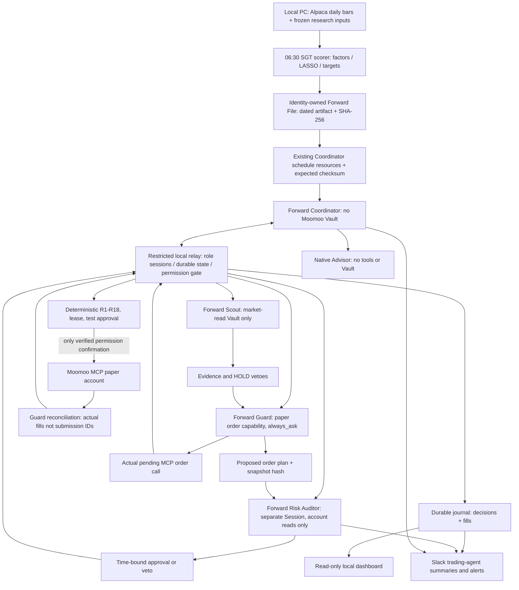

# PRD — Risk-Constrained Multi-Factor Paper Trading Team

Version 0.1.0 · 2026-11-19 · English submission draft following goal → rules → proof clarification.

## 1. Purpose, authority and scope

Build a reproducible, inspectable US paper-trading system using local Qoder, Qoder Cloud Agents (QCA) Forward Mode, Moomoo MCP and reusable skills. The local PC computes numerical signals; cloud agents verify evidence, coordinate and execute only through a deterministic permission boundary. Optimise risk-adjusted results and operational correctness, not headline return or trade count.

**This delivery is a runnable local scaffold and inactive cloud deployment specification.** It does not place orders, create schedules, upload private artifacts, configure cloud resources, or switch accounts. A passing offline test is not proof of a working cloud trading system. Cloud orchestration, authenticated approval ingestion, current broker eligibility and individual-fill reconciliation must be demonstrated separately before activation.

Source precedence: `notes/handbook-notes.md` (Handbook governs; T&C impose mandatory account/trading constraints), then `docs/submission-checklist.md`, then research implementations/results as historical evidence. Preserve those source files. Source notes are summaries, not proof of an unavailable original clause; unresolved organiser questions are release blockers, not invented rules.

### Approved clarification decisions

1. Keep v2/all21 as the default signal baseline; implement a separately labelled risk-constrained execution overlay. Do not promote v3 or ongoing lab variants without the owner's choice.
2. Release the stock/SPY core first after mandatory safety evidence. Complete presentation/bonus evidence alongside the run. Options are post-competition only.
3. Include SPY and pending orders in the 10% current-equity per-ticker limit and 70% × volatility-multiplier limits on both sides. Enforce the competition's distinct 40% **initial-equity** limit as well.
4. Reserve daily order capacity for liquidation. Stage initial entries across sessions; 20 long / 20 short is the eventual target, not a requirement to violate the 60-order budget on day one.
5. Permit approved reduce-only emergency limit exits throughout regular exchange hours, including the final half-day; never trade a closed market or use stale quotes to force liquidation. All test-account orders, including emergency exits, still require explicit approval.
6. No new positions/rebalances on 27 November. Begin final liquidation at 12:15 ET, aim to be flat by **12:45 ET on 27 November = 01:45 SGT on 28 November**; reconcile/cancel before the 13:00 ET close.
7. Preserve the five-exchange-session signal cadence anchored to 2021-11-18. Initial entry is a recorded bootstrap; blocked sessions do not accelerate normal cadence. Execution begins at 09:35, not the historical opening-auction price.
8. Use Forward Files API + schedule-specific resources. This task implements inactive adapters only. Subsequent publication needs separately authorised cloud writes.
9. Keep all roles in Forward but isolate privileged roles in separate Sessions via a restricted local orchestration relay. Replace unsupported historical child-version selection with frozen release-specific Templates, exact expected configuration versions/hashes and rejection on drift. Pin actual cloud skill-version identifiers and hashes.
10. Quotes/account snapshots ≤60 seconds; price band 25 bps; cancel/reconcile at 120 seconds; exact-order approvals expire after five minutes and are single-use. Unknown eligibility/borrow/earnings means no new exposure.
11. Scout HOLD freezes existing size; it does not set a held name's target to zero. It cannot prevent independently authorised risk-reducing exits.
12. Portfolio loss/drawdown stops plus rank-buffer exits are the stock exit plan. No new per-name take-profit/stop-loss or consecutive-trade-loss overlay is introduced. Relevant checklist items are addressed with this rationale, not falsely marked fully implemented.

### Source conflicts and implementation discrepancies

| Issue | Evidence | Resolution |
|---|---|---|
| 40% denominator | Handbook notes Paper Trading T&C: 40% of initial assets, price appreciation grandfathered but no adding | Enforce independently of the tighter 10% current-equity policy; permit reduce-only remediation of drift violations. |
| Scoring weights | Checklist: 25/30/30/15; Moomoo deck also says “55% Trade Strategy Modeling” | Use Handbook/checklist categories; identify 55% as inconsistent/possibly aggregated, not a replacement rubric. |
| November 27 SGT date | Early close 13:00 ET equals 02:00 SGT **next calendar day** | Use explicit November 28 timestamps in all runbooks and final-close evidence. |
| Historical hedge | v2 average SPY hedge 17.02% vs new 10% cap; stock legs exclude hedge in displayed gross | Shrink the book/hedge deterministically; publish separate constrained results. |
| Volatility targeting | v2 targets 10% only on new positions; realised annual volatility is 16.30% | Target is not a volatility guarantee; R4 constrains all exposure, including drifted positions. |
| Drawdown | v2 max drawdown −37.87%; new halt at −8% | v2 is not evidence that the new halt workflow or portfolio meets −8%; gaps can overshoot. |
| Fill time | Historical signal-close → next open; live 09:35 limit orders | Measure arrival slippage and missed fills; do not report historical opening prices as live executions. |
| Shorts | v2 does not check borrowability; v3 uses a current Alpaca asset snapshot | Live shorts require current Moomoo-compatible shortable and easy-to-borrow evidence, not Alpaca metadata alone. |
| Version pinning | General multi-agent docs describe Managed integer pins; Forward Session update resolves latest at configuration time | Use the owner-approved Forward release-lock policy; do not put ineffective `version` fields in a roster and claim a historical pin. |
| Credentials | Native child Threads share Session Vaults/filesystem | Privileged Scout/Guard/Auditor run in separate role Sessions. Coordinator has no Moomoo Vault. A separate thread is not a separate security boundary. |
| Official simulated-trading skill | Current official skill invokes the `moomoo` CLI with CLI OAuth | A skill ZIP does not install its executable or bridge MCP OAuth to CLI. Our paper workflow uses validated MCP bindings; CLI execution remains disabled. |
| Schedule window schema | Handbook/schema mentions start_at/stop_at; endpoint documentation has narrower trigger-policy fields | Preserve explicit dates in local manifests and deterministic gates. Verify accepted live schema before deployment; never assume an ignored field stops trading. |

## 2. Goals, metrics and rubric

| Rubric | Weight | Success measures and evidence |
|---|---:|---|
| Risk-adjusted return | 25% | Report competition net equity, daily returns, maximum drawdown, volatility, turnover, fees, financing/borrow and Sharpe with sample count. No minimum profit promise. Sharpe from only a few sessions is unstable; show N/A for insufficient/zero-variance observations and separate historical results. |
| Qoder and QCA use | 30% | Local Qoder build artifacts; Forward run/session/thread IDs; isolated roles; repeatable schedules; Slack delivery receipts; local dashboard; actual Qoder usage where available. Target ≥99% scheduled-cycle accounting (completed, failed or skipped), not claim 99% trading uptime without measurement. |
| Strategy and risk | 30% | 100% orders require verified account, rules and independent audit; zero real-account calls, blind retries or unauthorised orders. Every R1–R18/R0 boundary covered; 100% decisions/rejections logged; all actual fills reconciled or execution halted. |
| Reusability and documentation | 15% | Versioned agent/skill package; config-driven scorer; deterministic tests; four fixed evaluations and diffs; command-level reproduction; honest failure report and accessible presentation. |

Operational targets: completed-close artifact ready before 09:00 ET; measured end-to-end freshness displayed; unresolved stale inputs fail closed. Stock book aims for ≤45 total symbols, ≤60 executed orders per ET day including reserve, |beta|≤0.10 and defined gross caps. Emergency exits may transiently worsen beta while reducing gross; record that fact rather than claim atomic liquidation. Alert delivery and a 30-minute check interval are **not** protective stop orders.

## 3. Strategy baseline and evidence

### Locked default

- US common stocks: raw price ≥$1, current market cap ≥$500 million, trailing 20-session median dollar volume ≥$5 million. Exclude ETFs from scores; SPY is solely the beta hedge.
- 16 ported factors: pv1, pv3–pv12, md1_gap, dc1_approx–dc4_approx. Add mom12_1, high52, ivol60, rev21 and amihud. DCs are trade-count/close-location approximations, not US Level-2 flow. rev21 is 21-session reversal.
- Cross-section per date: 5 × scaled MAD winsorisation → z-score → OLS industry/standardised log-market-cap neutralisation → residual z-score. Fama-French-12 mapping is the code's abridged SEC-SIC mapping. Research imputes missing standardised values to neutral zero; report missingness/coverage and stop on systemic data loss.
- LASSO: trailing 252 sessions, retrain every five sessions, five-fold row-based TimeSeriesSplit and deterministic capped sampling as research. One-day next-open-to-next-open rank target; only labels observed by signal time enter training. Cache coefficients, selected alpha, training boundaries, factor order and source/config digests.
- Five-day score mean; 20 longs and 20 shorts; held names retained inside top/bottom 60 with drifted weights. Ideal 70% each stock leg; new-position volatility multiplier uses 20 daily returns, targets 10% annualised and clips to [0.3,1]. SPY neutralises estimated 60-day beta.
- Production overlay shrinks stock weights and SPY together to meet total-side/name/beta constraints. Unknown beta means HOLD, not the backtest's beta=1 fallback. Short eligibility filtering and staged entry are additional live differences.
- v3 uses a residual five-day target, inverse-vol variant, ≥$1B short filter and also two extra factors. Its presence/completion does not select it automatically.

### Historical results, not a promise

`reports/backtest_v2/metrics.json`: 2021-11-18 through 2026-11-17, 1,254 rows; net annual return 7.4265%, Sharpe 0.5212, max drawdown −37.874%, average daily turnover 5.482%, realised beta 0.0319. The baseline `backtest` best trial returned −1.410% annual with Sharpe 0.0873 and −49.78% drawdown. `backtest_v21` confirms all21/v2risk matches v2; its full-book risk variant is different and not adopted.

Disclose material limitations: current active-company universe/survivorship and changing share classes; static/abridged industry classifications; SEC availability approximated as period-end+60 days rather than verified filing timestamps; restatements/corporate actions; row-level CV can split a date and lacks a purged embargo; model selection across repeated variants is not pristine untouched OOS; backtest fee/slippage model omits real fill queues, partial fills and some charges. The reported very low Deflated Sharpe probability is evidence **against treating the chosen trial as a robust proven edge**; do not omit it. Forward paper results are the real new holdout. Original artifacts remain unchanged; additional risk-overlay replay is separately labelled and is not a new five-year validated backtest.

## 4. Architecture and authority

All model reasoning stays in QCA Forward. The already-always-on PC gains a small trusted control relay, approved to preserve isolation/release locks; this is a dependency and single point of failure, not an invisible extra agent. This scaffold provides local validation/storage and inactive transport, **not an enabled event-processing relay**. No cloud success is claimed until that relay and its authentication are implemented and verified in a later authorised task.

| Role | Recommended template | Tools / credentials | Own output |
|---|---|---|---|
| Coordinator | Deterministic workflow coordinator, strong model during validation | Restricted delegation/status tools and tool-free Advisor; no Moomoo MCP, account secrets, order tools or generic credential access | Run manifest, task status, summary only |
| Scout | Evidence checker, not stock picker | Moomoo quotes/news/digest/sentiment where supported; read-only market Vault; no account/order writes | `scout/<run>/vetoes.json` |
| Guard | Narrow paper portfolio executor | Account/quote/order-status reads; only paper order/cancel tools, mandatory `always_ask`; Vault only in Guard Session | `guard/<run>/plan.json`, reconciliation outputs |
| Risk Auditor | Independent veto-only portfolio reviewer | Read-only paper positions/cash/order state and market evidence; separate Session/Vault; no execution | `auditor/<run>/approval.json`, daily risk report |
| Advisor | Independent second opinion | Native Advisor, no tools, credentials or action authority | Recommendation in consultation event |
| Trusted relay | Code, not an LLM agent | Narrow QCA PAT/SAT scope; local immutable release/config and approval verifier; no strategy discretion | Durable journal and account lease |

Do not invent model IDs, Template IDs, Vault IDs, skill versions, Identity IDs or Slack binding IDs. Populate release locks from verified resources in the later deployment task. Prefer one strong model for review initially; switch narrow tasks to cheaper models only after identical regression evidence. Native Collaboration is enabled only for permitted nonprivileged coordination/Advisor use; role isolation takes precedence over making every role a native child thread.

### Deterministic execution boundary

A prompt saying “run the rule gate” is insufficient. Every raw paper order/cancel/modify capability must be restricted at the platform permission layer. Guard's MCP calls emit `agent.mcp_tool_use` with `evaluated_permission=ask`; the trusted relay validates the **actual raw arguments**, not an earlier paraphrase, against a fresh snapshot and approved plan. Only then can a future relay emit `user.tool_confirmation`. If enforcement, identity or raw-tool mapping cannot be verified, deny. Remove generic Bash/network/CLI avenues around this boundary. Other agents get explicit read allowlists; unknown/new tools are denied.

Human Slack approval cannot override R1, competition limits, stale data or a failed rule. Test approval identifies exact symbol, side, quantity, limit price, rationale, complete rule results, plan/target/config/account hashes and expiry. Bind approvals to an authenticated owner identity, persist consumption atomically before submission, and never accept a model-generated “approved” field as authentication. Scaffold `verified_by_relay` fields are fixture/trusted-boundary inputs, **not a security mechanism by themselves**.

Each actual order requires an independent Auditor attestation. Re-reading positions after a fill changes the snapshot and invalidates earlier attestation; request a refreshed approval or a separately audited sequence. Account-level leases apply across every schedule/run, not just a single schedule's `max_concurrent_runs`. Preserve unresolved orders on restart; an expired lease never means an unknown broker submission is safe to repeat.

## 5. Deterministic rule table

Every result records ID, threshold, observed value, pass/fail and action. NaN, missing fields, wrong types and ambiguous states fail closed. Risk-reducing relief never permits crossing through zero into a new position.

| ID | Condition / threshold | Action | Unit-test focus |
|---|---|---|---|
| R0 | Complete finite typed contract, whole-share positive quantity, valid side/intent | HOLD | Missing keys, booleans, NaN/Inf, negative values |
| R1 | MODE=test only 5322438; MODE=competition only 5832812; SIMULATE; config/snapshot/order agree | BLOCK + durable rejection + alert | Other ID, opposite mode, REAL account |
| R2 | US common stock or SPY beta hedge; $1 price, $500M market cap, $5M 20-day median dollar volume; new shorts shortable AND easy-to-borrow; known halt/earnings status | HOLD name/no entry; permit valid reduce-only exit without requiring renewed borrow eligibility | Boundary values, unknown status, ETF misuse, unborrowable short |
| R3 | Each ticker, including SPY and committed orders: ≤10% current equity AND ≤40% initial equity | Block increases; allow reductions of already-breached holdings | Two denominators, SPY, pending quantity |
| R4 | Total long ≤0.70×mult and total short ≤0.70×mult, including SPY, retained drift and worst-case pending entries | Resize proposed book or block; reduce-only remediation allowed | Pending offsets cannot create artificial headroom |
| R5 | Absolute estimated portfolio beta ≤0.10 after each nonemergency step, with pending-entry uncertainty | HOLD/replan; emergency reduce-only exits can transiently worsen beta and are logged | Missing beta, excess beta, partial sequences |
| R6 | ≤45 symbols; ≤60 distinct executed order IDs/day with pending commitments and reserved exits; competition ≤200 | Stage/defer entries, never blind retry; no emergency exception to 60 | Boundary counts, partial order counted once, reserve |
| R7 | Regular rebalances 09:35–15:45 ET; LIMIT, RTH, DAY; price within 25 bps of fresh reference | HOLD; emergency reductions only within actual regular session | Market order, time boundary, price band |
| R8 | Net equity / previous official-close equity −1 ≤−2% | No new entries for rest of ET day, reductions permitted | Exact threshold and day rollover |
| R9 | Equity / persistent high-water mark −1 ≤−8% | Cancel risk-increasing orders, flatten, persist halt until explicit owner rearm | Boundary precision; no automatic peak reset |
| R10 | Trusted artifact checksum/config/mode; signal ≤2 completed exchange sessions old; no future dates | HOLD rebalance | Corruption, stale signal, holidays; emergency liquidation uses current verified risk state, not stale alpha |
| R11 | Verified current quote and account snapshot, age 0–60 seconds | HOLD and alert if exit blocked | Missing/future/stale quote and account |
| R12 | Submission ≠ fill; inspect current and historical orders; reconcile partials; stale after 120s; cancel then confirm | RECONCILE/HOLD; unknown outcome blocks repeat; no same-symbol overlap or reversal order | Duplicate client ID, cumulative regression, cancelled-partial, uncertain cancel |
| R13 | Exchange calendar, competition bounds, Thanksgiving, final half-day | Nov26 no trading; Nov27 exit-only; final-flat goal 12:45 ET | ET/SGT dates, weekend, early close, out-of-window |
| R14 | Independent Auditor Session; approval binds mode/account/plan/snapshot/target/config; ≤5-minute life | HOLD without valid approval | Same Session, stale hash, expired approval |
| R15 | Test every order has exact, authenticated, unused owner approval; competition no human bypass of hard gates | AWAIT_APPROVAL / BLOCK | Changed size/price, replay, expiry |
| R16 | Durable manual kill control, default halted/unarmed | HALT except authorised reduce-only liquidation | Missing control; latch survives restart |
| R17 | Frozen release/config verified; account-wide lease; mandatory tool policy; only paper-trading workflow | HALT | Version drift, concurrent run, unknown capability |
| R18 | Actual order is in checksum-bound plan, moves toward target, no Scout veto increase; target READY | HOLD/re-audit | Invented symbol/size, modified plan, HOLD semantics |

Margin/buying-power and minimum-three-symbol full-investment constraints are additional deployment preconditions from the T&C. Before any real paper execution, map Moomoo buying-power/margin fields and reject a batch that can breach them. The local gate does not claim that gross exposure alone proves margin sufficiency. All executed-order counting uses the broker's ET-day definition once verified; cancellations/modifications are not counted as executions, but replacement executions may consume additional slots.

### Staging and failure handling

A full 41-name initial book needs up to 41 entry orders plus 41 reserved exits, exceeding 60. Start with a balanced, beta-feasible subset (approximately 14+14+SPY if feasible; never force that count). Continue toward 20/20 in a later session inside fresh approvals and budget. Use actual fills, not expected fills, to recompute capacity. For partial fills, keep remaining quantity reserved until cancellation is acknowledged. If stock/hedge ordering cannot stay within beta/margin/name limits, shrink the next step or HOLD; a valid final target is not sufficient proof that its execution path is safe.

### Strategy invalidation and kill switch

Immediate operational invalidation: account mismatch; missing trusted state; artifact/config/provenance mismatch; persistent model/feature failure; release drift; missing permission enforcement; unknown order outcome; unexplained positions/cash/fills; unavailable borrow/market evidence. Stop new exposure and alert. Economic hard stops remain R8/R9; sustained signal decay, excessive slippage/carry, new regime behaviour or unexpectedly concentrated factors trigger an owner review, not an invented automatic strategy change based on a tiny competition sample.

1. Owner issues a kill request through the future authenticated control channel or invokes the local halt command. Latch account, timestamp, reason and operator; default is halted.
2. Relay refuses new entry confirmations immediately. Pausing schedules alone is insufficient: active Sessions and open broker orders still exist.
3. Inspect and cancel pending risk-increasing orders through the same verified paper-only boundary. Reconcile cancellations and all partial fills.
4. Obtain independent risk approval for a reduce-only liquidation plan; in test mode obtain exact human approval for every exit as well.
5. Place bounded regular-hours limit exits only while fresh quotes exist and capacity remains. Alert on halts, closed markets, unknown fills, insufficient capacity or stale data; never falsely report FLAT.
6. Confirm zero stock/SPY quantities and no open orders using broker state; persist final equity, charges and reconciliation evidence. Keep the latch set.
7. Rearm only by an authenticated owner action after root-cause review, tests/evaluations, fresh account state and release verification. Do not reset the drawdown peak automatically; resetting a strategy reference requires an explicit documented owner decision. Never use a Moomoo Reset Card.

A 30-minute risk monitor cannot guarantee a −2% or −8% realised loss ceiling. Gaps, halts, outages and limit non-fills can exceed thresholds. No naked options, real accounts, crypto or futures are in scope.

## 6. Data contracts and persistence

### `live/out/targets_YYYYMMDD.json`

Filename date is **US signal session date**, not Singapore generation date. JSON UTF-8, canonical keys sorted, compact separators, ASCII escapes, no NaN/Infinity. `checksum` is lowercase SHA-256 of the canonical JSON object excluding the `checksum` field; it is not a hash of arbitrary whitespace in the file. Publication additionally records a byte digest and source provenance. A checksum detects alteration, not authorship; the trusted relay supplies the expected value out of band from its own publication ledger.

| Field | Type / meaning |
|---|---|
| schema_version | Integer 1 |
| strategy_id / mode / status | `v2-risk-constrained`; `test` or `competition`; `READY` or `HOLD` |
| signal_date | Valid completed XNYS session, YYYY-MM-DD |
| generated_at / data_timestamp | Timezone-aware RFC3339 UTC; generation time vs latest complete market data time |
| weights | Map canonical unprefixed common-stock symbol → signed fraction of account equity; excludes SPY |
| spy_hedge_weight | Signed SPY fraction; no ETF alpha scores |
| vol_multiplier | Finite (0,1], baseline clip [0.3,1] |
| model_coefficients | Factor-name → coefficient; immutable factor ordering and alpha/training boundaries retained in model metadata |
| config_checksum | SHA-256 of exact approved configuration |
| position_snapshot_checksum | Digest of EOD account snapshot used for holdings/buffer construction, not a claim that it remains fresh for execution |
| checksum | Canonical payload checksum |
| Additional provenance | Training/factor/source versions, coverage, reasons for HOLD, model fit date, rebalance eligibility, limitations |

Empty weights must not ambiguously mean “liquidate”: `HOLD` means no alpha rebalance; a liquidation requires an independently approved risk plan. Reject duplicate JSON keys on external ingestion, duplicate symbols and unsupported schema versions. Prices/quantities come from fresh broker snapshots when translating targets into orders; round toward zero to whole shares. Persist the residual cash/rounding and do not silently inflate other names to use it.

### `journal/decisions.jsonl`

One object per event, including NO_ACTION, HOLD, rejected proposals, exceptions and failures. Required business fields: `event_id`, `timestamp`, `mode`, `account_id`, `run_id`, `session_id`, `agent`, `kind`, `symbol` (nullable), `action`, `reason`, `rule_checks`, `target_checksum`, `order_fingerprint`, `config_checksum`. Add broker/tool/event IDs, approval ID, release ID and input provenance when applicable. Each rule check contains `id`, `passed`, `threshold`, `observed`, `action`. Never store credentials, signed URLs, request headers or raw authentication responses. Log the requested unexpected account for an R1 rejection, but never query or trade it.

### `journal/fills.jsonl`

Deduplicate by `(account_id, order_id, fill_id)`, not submission response. Fields: event/time/mode/account/run/session, `order_id`, actual `fill_id`, `symbol`, `side`, **incremental** `quantity`, `price`, `commission`, `platform_fee`, `regulatory_fee`, `arrival_price`, `slippage_bps`. Include currency, fee provenance and correction links. Use null for unavailable fees, not zero. `slippage_bps = side_sign × (fill_price / arrival_price − 1) × 10000`, BUY sign +1, SELL sign −1. Financing/borrow accruals are separate accounting events, not fabricated fills. A cumulative order update can signal a new fill but is not an individual fill identity.

The trusted relay is the single durable writer. SQLite/WAL stores deduplication/control/leases and regenerates JSONL projections after a crash; cloud per-run artifacts are staged in `journal/incoming`, checked, then ingested. Never use ephemeral QCA sandbox files as the only journal. Parent session events do not contain all child events: collect role Sessions and native consultation Threads separately. Preserve original submitted/cancelled/partial states and distinguish broker-confirmed vs reconstructed P&L.

## 7. Local job and cloud transfer

Windows Task Scheduler definition is an **unregistered local specification**, scheduled 06:30 Asia/Singapore Tuesday–Saturday. During this window that is 17:30 ET on the preceding US date. Use an explicit virtualenv executable and project working directory. Skip when the previous US session is a holiday; never create a “new” signal from Thanksgiving data. Completed-close identity, not file modification time, governs freshness. Failed scoring retains the last immutable artifact but records failure; a newer filename never makes old bars fresh.

Incremental ingestion reads Alpaca credentials only from local environment/`.env`, fetches raw and adjusted bars with overlap and pagination, aligns sessions/symbols, and writes a separate live cache instead of overwriting research datasets. Corporate actions can change prior adjusted bars: invalidate/rebuild affected history or HOLD pending verification. Refresh common-stock identity, SEC information and current broker borrowability separately. A current Alpaca active-asset snapshot is not Moomoo short approval.

**Approved transfer mechanism**:

1. Finalise/validate artifact locally; preserve one approved content digest per mode and signal date. Save a publication ledger before any remote binding update.
2. Upload with `POST /api/v1/forward/files`, multipart file, PAT `identity_id` query when applicable, and date/hash idempotency key. Identity-bound SAT ownership comes from the credential: no `identity_id` query.
3. Read the existing authorised schedule(s), preserve unrelated resources/instructions/sinks and replace only the previously owned target resource. Use `POST /forward/schedules/{id}` with `resources` plus updated string `initial_events` naming date/path/expected checksum. Never recreate schedules for daily files.
4. No mid-run rollover. Each attempt selects dedicated resources; subsequent attempts can select newer resources. Use new_session, max_attempts=1, max_concurrent_runs=1 plus the cross-schedule account lease. Inherited Template/Identity files are outside that snapshot, so daily targets must not be mutable inherited bindings.
5. Read back bindings/run inputs and record IDs, input version, attempt and checksums. Resources alone do not increment initial_events_version. GET-before-POST is not atomic compare-and-swap: keep a single authorised configuration writer and reject detected concurrent changes.
6. Retrieve delivered artifacts via `agent.artifact_delivered`, the Files content endpoint and its short-lived URL; download without forwarding the PAT to the artifact host. Only approved download hosts and bounded files are accepted. No signed URL is logged.

Files are not documented as read-only/WORM mounts; recheck the digest before audit and execution. Uncertain writes are queried before retry; no automatic replay of non-idempotent orders. Private GitHub with exact commit+hash and read-only cloud access is fallback only, not provisioned here.

## 8. Schedules and Slack

All cloud schedules target **one Coordinator**, not independently scheduled trading children. Planned activation begins 2026-11-20 09:00 ET; planned trading ends with the November 27 early close; a final reporting stop is 16:30 ET November 27. The exchange/competition gate is authoritative even if a trigger fires outside its intended window. Validate the original Handbook's precise official opening timestamp before registering tasks; the operational start is deliberately later than the already-open competition.

| Job | America/New_York | Cron concept | Action / output |
|---|---|---|---|
| Local scores | 17:30 previous ET day; 06:30 SGT Tue–Sat | Windows weekly trigger | Complete-close target; readiness/failure record, no order |
| Readiness | 09:00 weekdays | `0 9 * * 1-5` | Scout evidence + Auditor account health → Slack |
| Rebalance/drift | 09:35 weekdays | `35 9 * * 1-5` | Rebalance only on eligible next session of anchored signal/approved bootstrap; otherwise check risk |
| Intraday | 10:00–15:30 every 30 min | `0,30 10-15 * * 1-5` | Exposure, loss, freshness, pending orders; skip after actual close |
| EOD | 16:10 full sessions | `10 16 * * 1-5` | Reconciled report → Slack, journal, dashboard |
| Final liquidation | Nov27 12:15, deadline12:45 | Date-bounded one-time specification | Reduce-only liquidation; no new rebalance |
| Early-close report | Nov27 13:10 | Date-bounded one-time specification | Final reconciliation and competition mark; no 16:10 trading |

November 26: all market actions skipped; optional nontrading health notice. November 27: no readiness-triggered entries or normal rebalances; risk checks only before 13:00, plus final exits. Exceptions/skip reasons still logged. No new entries after the final liquidation workflow begins. Triggers, accepted messages and submitted orders are not completions/fills. Confirm schedule ID, next run, timezone/window and manual test evidence after future registration.

Slack `#trading-agent` is reported connected by the source checklist; this task does not recreate its bot or verify the live binding. Message templates:

- **READINESS** `[test|competition] account … | signal … hash … | quotes … | Scout vetoes … | Auditor PASS/VETO | action HOLD/READY | next check … ET`.
- **APPROVAL REQUIRED** `BUY/SELL symbol quantity @ limit | rationale … | all rule outcomes … | target/plan/order fingerprint … | expires … UTC | exact authorised owner approval required`.
- **BLOCK / HALT** `R# | observed vs threshold | current/pending exposure | no order sent OR unknown outcome | operator action required | next safe reconciliation step`.
- **EXECUTION** `submitted ID … is not a fill | filled … / remaining … | actual fees … / unknown | cancellation status …`.
- **EOD** `equity | net day/cumulative P&L | drawdown | long/short/SPY/beta | fill/fee reconciliation | holds/errors | run/session IDs | what failed, why, what changed`.

Alert delivery failure is logged separately from trading outcome. Slack is a human control/notification channel, not durable state or a means to bypass mandatory rules. No personal account IDs/tokens or signed URLs in public presentation screenshots; redact operational IDs as appropriate.

## 9. Dashboard specification

Read-only, local loopback server; no order buttons or browser-held PAT/Alpaca/Moomoo/Slack credentials. Any later QCA/account adapter runs server-side with explicit scope. Fixture mode has a prominent synthetic-data banner; default without state displays not connected, never fictional profits.

Views: account/mode/execution-status banner; equity and daily/cumulative net P&L; equity curve and drawdown; gross long/short, net exposure, SPY hedge and estimated beta; holdings quantities/weights/cost/current prices; open orders and partial fills; decision/rejection log with rule filters; role/session/last-seen status; latest scheduled cycle including errors/skips; Qoder credits/usage with source timestamp and N/A when unavailable. Include commissions, platform/regulatory fees, slippage and financing/borrow separately. Label estimated versus broker-confirmed values.

Use accessible contrast, responsive layout, keyboard-operable filters, safe text rendering and explicit loading/error/stale states. Acceptance includes live browser golden-path checks, empty data, filter operation, failed refresh and no XSS from news/reason strings. Record a 1–2 minute demo only after real paper evidence exists; fixture footage must remain labelled.

## 10. Acceptance and release gates

### Deliverable-local evidence

- Rule table IDs and boundary tests cover R0–R18; all tests run offline. Both allowed and rejected paths are exercised. Test outcomes do not arm execution.
- Contract checks reject corrupt/stale/future files, unsupported types, configuration mismatch and invalid account. Immutable outputs cannot be overwritten silently.
- Scorer fixture runs end-to-end, outputs finite factor coefficients and constrained targets; known research mechanics remain identifiable. Pure overlay replay uses separate outputs and labels.
- Transport tests prove dry-run default, preserved unrelated resources and expected-hash binding. No cloud write is executed.
- Journal deduplication, partial-fill transitions, crash recovery, halt persistence and account leases pass; logs contain no credentials.
- Dashboard runs locally and is tested in a browser, including fixture/empty/error states. Usage without source data is N/A.
- Four fixed evaluation prompts and expected outcomes are stored and versioned. Local spec/schema checks are not a claim that the cloud agents answered correctly.

### Mandatory future MODE=test evidence on 5322438

1. Verify account list identity/type/market and the separate competition ID without ever selecting a default/first account; no Reset Card, no REAL-account calls.
2. Verify isolated role Sessions, no Coordinator Moomoo Vault, narrow read allowlists, order-tool `always_ask`, disabled raw bypass, exact release/skill locks and authenticated owner approval source.
3. Run the four fixed prompts in actual QCA Sessions, save output/events and diff against approved expectations. Include wrong-account injection, stale/corrupt evidence, expired approval, partial/unknown fills, drawdown and holiday cases. Any prompt/skill/model change repeats this gate.
4. Complete one full US-session shadow run: schedules simulated/manual in the later task, identical target/report path, no unauthorised orders; account leases, file transfer and Slack receipts reconciled.
5. In a **separately authorised task**, obtain explicit per-order approval for small paper long and short entry/exit round trips. Prove fills, fees, positions and P&L; exercise one stale cancellation/partial-fill scenario if observable, otherwise mark its broker evidence missing rather than simulate completion.
6. Rehearse kill, connection loss, unknown-submit response, restart and final-session liquidation with approved test orders or clearly labelled fixtures. Show that an uncertain submit never doubles an order.
7. Verify broker buying power/margin, current shortability/ETB and individual-fill/fee data availability. Run separate constrained-overlay replay and disclose unrepaired CV/point-in-time assumptions. Real daily returns remain separate from synthetic replay.
8. Owner signs release record with evidence links, exact config/Template/skill digests and unresolved noncritical issues. Only then change deployment MODE to competition, bind only 5832812 and explicitly authorise cloud activation. Do not treat a November 20 deadline as permission to skip a failed gate.

## 11. Complete checklist coverage map

Status terms: **local** = provided/testable here; **later** = planned deployment/evidence; **disclosed** = intentionally different/deferred. A checklist item having a design is not proof it has been achieved.

| Item | Design and required evidence | Status |
|---|---|---|
| A1 | Local Qoder implementation + actual Forward run IDs | local + later |
| A2 | All project artifacts inside this workspace | local |
| A3 | Existing connector/skills/plugin; verify in each execution environment | source-reported; later verification |
| A4 | Isolated role Vaults, exact MCP URL match | later release gate |
| A5 | One skill ZIP per name, validated package and returned cloud version | local packaging + later upload |
| A6 | Coordinator/Scout/Guard/Auditor with mandatory independent audit | local specs + later execution |
| A7 | Collaboration/Advisor under the approved isolation design | local specs + later proof |
| A8 | Least privilege and single-writer ownership matrix | local specs + later enforcement |
| A9 | Frozen Forward release/config hashes; true skill pins; historical child pins unsupported | disclosed replacement + later locks |
| A10 | Existing Slack channel, readiness/alerts/EOD receipts | source-reported + later |
| A11 | Explicit NY schedule/window/holiday plan, IDs/next-run/manual-test proof | local plan only; later |
| A12 | One scheduled Coordinator, cross-schedule account lease | local design + later |
| A13 | Local read-only dashboard, server-side adapters | local fixture + later real data |
| A14 | Usage pane with actual source or N/A; Qoder Sites optional future publication | local pane + later evidence |
| A15 | Honest live screen recording | later Nov28–29 |
| A16 | Approved shared nonsecret context/wiki; not an authority for approvals or state | later, not configured here |
| A17 | Credit budgets/usage, cheaper model only after regression | local policy + later measurement |
| A18 | Goal/rules/proof PRD rounds; future QCA Assistant debugging evidence | local + later |
| A19 | Alpaca historical/local incremental market data | research exists + local scorer |
| B1 | Exact v2 baseline and separately disclosed risk overlay | local |
| B2 | Operational/economic invalidation conditions | local |
| B3 | 10% name, gross/beta/count/order reserve and disabled options | local + broker evidence later |
| B4 | −2% entry halt, −8% persistent flatten halt; no consecutive-trade overlay | local; streak item disclosed |
| B5 | Durable kill procedure; active-run/open-order reconciliation | local scaffold + future rehearsal |
| B6 | Deterministic gate, hard-coded mode accounts | local |
| B7 | Portfolio stops + rank-buffer exits; no per-name profit target | disclosed stock exit policy |
| B8 | RTH-only entries, bounded limit orders, emergency regular-hours distinction | local |
| B9 | Thanksgiving closure, final half-day exit deadline with next-day SGT date | local |
| B10 | Options post-competition: no current order capability; require expiry/leg tests before enabling | disclosed deferred, not achieved |
| B11 | Test exact approvals vs competition deterministic auto-confirmation | local contract + later authenticated relay |
| B12 | Actual-order validation + submission/fill separation | local + future broker evidence |
| B13 | Small approved long/short round trips on 5322438 | later; never claimed from fixtures |
| C1 | Net Sharpe reporting with sample-size/selection caveats | local methodology + later results |
| C2 | Fee/slippage/financing/borrow accounting with unknowns marked | local contract + later reconciliation |
| C3 | Partial fills, remaining commitments, no assumed 20×volume fills | local tests + later broker evidence |
| D1 | Five readable role templates/specs and registry | local |
| D2 | Reusable target/rule/reconciliation/report/research skills | local |
| D3 | Timestamped AGENTS.md version log and unbound-cloud status | local |
| D4 | Existing git; preserve user changes; no unsolicited commit; future verified cloud diff | local + later release commit |
| D5 | Four fixed evaluations, version/output diff after changes | local harness + later cloud runs |
| D6 | Durable structured rejection and decision logs | local |
| D7 | v1 baseline vs v2; separate constrained replay and forward holdout; disclose CV limitations | local/research + later proof |
| D8 | README, pinned local dependencies, test/demo commands | local |
| D9 | Qoder-generated deck/HTML presentation | later Nov28–29 |
| D10 | Daily honest failure/learning section and labelled demo | local template + later observations |
| D11 | Versioned strategy/config history without silently adopting new variants | local + later release history |

### Submission package

Mandatory form: owner enters their own name, Luma email, country/phone and consent selections and clicks submit. We do not fill personal information or submit. Provide a Qoder-generated presentation link ≤100 characters, project sentence ≤100 characters, description ≤1000 characters and optional repository link ≤100 characters. The presentation must be judge-accessible; test in an incognito session before submission, without exposing account secrets. Include strategy, roles, rule table, actual competition results, limitations, failures, source/version evidence, reproduce commands and optional 1–2 minute video.

Draft sentence: **“A risk-gated multi-agent US paper trader built with Qoder and QCA.”**

Draft description (replace results only with verified observations): “Built with local Qoder and Qoder Cloud Agents, this US-only paper trader combines 21 daily factors with rolling LASSO. A local scorer produces verified target files; separate Forward agents check news, audit risk and manage paper orders. Deterministic account, exposure, beta, freshness, approval and drawdown gates protect execution. A dashboard and structured journal expose decisions, rejections, fills, costs and agent activity. The submission separates historical research, constrained replay and observed competition results, with reusable skills, versioned templates and regression tests.”

## 12. Risks and open questions

- **Activation blockers:** real Forward role-session relay and signed/authenticated approval ingestion; permission-policy verification; DAY time-in-force semantics (the discovered `sim_trade_input_order` schema exposes no TIF parameter); current Moomoo common-stock/ETB/earnings/halt evidence; broker buying-power checks; fill and fee reconciliation; source data/corporate-action freshness; actual cloud evaluation/shadow/round-trip evidence. Missing capability means HOLD, never switch to a live-trading tool.
- Exact official competition opening/end timestamps and daily execution counting/fill-fee semantics must be confirmed against the original Handbook/T&C. The operational plan avoids holiday entries and exits before the final regular close.
- A 60-order budget with liquidation reserve may limit achievable diversification and turnover. Staging is approved but can produce temporary underinvestment.
- Five-day smoothing/training warmup require enough historical sessions; local resource consumption and late jobs must be measured. Existing research jobs are not stopped or overwritten.
- Frozen Forward templates prevent drift only with verified snapshots and a single config writer; they are not a platform historical-version selector.
- Cloud Files mounts are mutable and session files ephemeral. Artifact hashes and local durable state are mandatory; checksums alone are not authentication.
- The PC/relay, network, Alpaca entitlement, Vault OAuth and QCA budget can fail independently. Do not assume a running scheduler implies a functioning agent or protective exit.
- Research factor/microstructure assumptions, current-universe bias and parameter selection weaken evidence of a durable edge. No backtest metric guarantees competition performance.
- Options post-competition require optionability, underlying allocation budget, ≤2% equity premium per trade, calls top1%/puts bottom1%, no naked shorts, expiry/calendar closure and individual-leg protection tests before any enablement.
- Shared memory/wiki and Qoder Sites publication are future optional deployment operations requiring explicit scope/access approval; this task makes neither change.

## 13. Day-by-day execution plan

| Date (2026) | Deliverables / gates |
|---|---|
| Nov19 Thu | PRD rounds and source review; local specs, contracts, rules/tests, scorer fixture, inactive transfer and dashboard; preserve research jobs. Begin shadow only in a separately authorised configuration task. |
| Nov20 Fri | Complete a full-session shadow/evaluations and separately approved paper round trips if feasible. Sign go/no-go evidence. Competition first staged entry in US session only after all gates pass; otherwise delay and explain. |
| Nov21 Sat | Review Friday EOD/scoring, incident log and accounting; no weekend stock orders. |
| Nov22 Sun | Dry-run Monday readiness; check release/config/skills and data delivery; no trading. |
| Nov23 Mon | Continue approved staged build or anchored rebalance; daily risk/fee reconciliation, usage and Slack evidence. |
| Nov24 Tue | Operate within limits; capture rejection example, account/agent dashboard evidence; no performance-driven strategy swap. |
| Nov25 Wed | Normal gated operation; monitor scheduled macro/news risk and thinner holiday liquidity; verify final-close readiness. |
| Nov26 Thu | US market closed: no orders; offline failure review, tests, documentation and video preparation. |
| Nov27 Fri | No rebalance/entries; monitor before early close; begin exits12:15ET, target flat12:45ET, confirm/cancel before13:00; report13:10ET. These late times fall on Nov28 in SGT. |
| Nov28 Sat | Reconcile final competition state/results; Qoder-generated deck/HTML and labelled live-evidence recording; package reproducible repository and release artifacts. |
| Nov29 Sun | Verify judge-accessible links/incognito access, form limits, credential redaction, version evidence and honest limitations. Owner submits. |
| Nov30 Mon | Official deadline23:59SGT; reserved buffer, not planned submission day. |

## 14. Verified platform references

- Forward file upload: https://docs.qoder.com/cloud-agents/api/forward/files/upload.md
- Schedule resource semantics: https://docs.qoder.com/cloud-agents/api/forward/schedules/schemas.md
- Schedule updates: https://docs.qoder.com/cloud-agents/api/forward/schedules/update.md
- Forward version-resolution limitation: https://docs.qoder.com/cloud-agents/api/forward/sessions/update.md
- Session/thread/Vault boundaries: https://docs.qoder.com/cloud-agents/multi-agents.md
- Mandatory tool confirmations: https://docs.qoder.com/cloud-agents/permission-policies.md

These references support design decisions, not a claim that this account's cloud resources have been inspected or configured.
