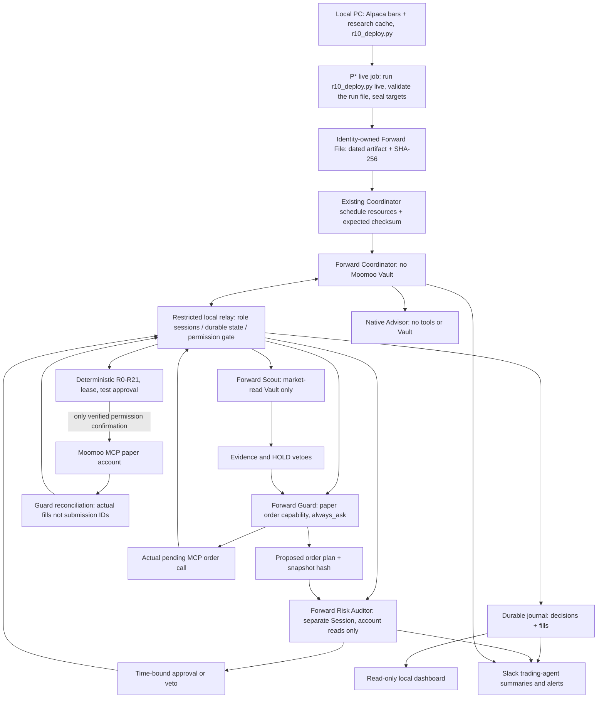

# PRD — Risk-Constrained Multi-Factor Paper Trading Team

Version 0.3.0 · 2026-11-20 (evidence recorded 2026-11-19 UTC) · English submission draft following goal → rules → proof clarification. The deployment default is now the frozen portfolio **P\*** (variant `pstar15`), wired through `research/r10_deploy.py` as the single source of truth. The round-5 configuration `frozen-short-alpha-half` ("Plan A") is retired to `strategy: legacy-a` with execution disabled; its code and tests still run.

## 1. Purpose, authority and scope

Build a reproducible, inspectable US paper-trading system using local Qoder, Qoder Cloud Agents (QCA) Forward Mode, Moomoo MCP and reusable skills. The local PC computes numerical signals; cloud agents verify evidence, coordinate and execute only through a deterministic permission boundary. Optimise risk-adjusted results and operational correctness, not headline return or trade count.

**This delivery is a runnable local scaffold and inactive cloud deployment specification.** It does not place orders, create schedules, upload private artifacts, configure cloud resources, or switch accounts. A passing offline test is not proof of a working cloud trading system. Cloud orchestration, authenticated approval ingestion, current broker eligibility and individual-fill reconciliation must be demonstrated separately before activation.

Source precedence: `notes/handbook-notes.md` (Handbook governs; T&C impose mandatory account/trading constraints), then `docs/submission-checklist.md`, then research implementations/results as historical evidence. Preserve those source files. Source notes are summaries, not proof of an unavailable original clause; unresolved organiser questions are release blockers, not invented rules.

### Approved clarification decisions

1. Research is finished and the deployment default is the frozen portfolio **P\***, defined only in `research/r10_deploy.py` (`VARIANTS`, `DEPLOYED`, `run_pstar`, `ticker_weights`, `apply_caps`, `simulate`, `cmd_live`): the T9 ETF trend sleeve plus the D77 no-estimation short book of 77 names, blended by Ledoit-Wolf minimum variance and scaled by the frozen `K`. Two variants exist and the config selects one: `pstar` (round 10, 11 factors, K = 1.4633955775862155) and `pstar15` (round 14, 15 factors, K = 1.488567942168242); **deployed = `pstar15`**. Switching variants is a one-line change to `variant` in `live/config.pstar.json`, never a code change, and no other component re-implements the strategy. Plan A (`frozen-short-alpha-half`, source configuration `R4_E11cf_shortspy_n20` in `reports/lab/FINAL.json`) stays in the repository as `strategy: legacy-a` with `execution_enabled: false`, its rules, scorer and tests unchanged; the v2/all21 result remains a separately labelled historical baseline. No role may re-tune either frozen parameter set.
2. Release P\* as it is — in the current book roughly nine tenths ETF trend and one tenth broad short alpha — after mandatory safety evidence. Complete presentation/bonus evidence alongside the run. Options are post-competition only.
3. Include discretionary (strategy-unopened) holdings — the `discretionary_symbols` whitelist is empty today, because the Anthropic IPO trade was cancelled on 2026-11-20, and a holding the journal cannot attribute is still treated as discretionary and flagged unclassified — in the per-ticker and margin denominators: **any** ticker ≤38% of initial assets, SPY overflow above that cap routed to DIA then QQQ by their 60-day beta to SPY, margin `0.5 × long gross + 0.6 × short gross` ≤90% of equity, and ≤100 positions, discretionary names counted in all three.
4. Reserve daily order capacity for liquidation. The go-live day is **one ENTRY batch**: a full book names 82 targets — the 2026-11-18 fixtures and the 2026-11-19 rebalance run all name 82 — and the batch you can actually submit depends on the opening prices, because a name that rounds below one whole share is skipped without redistribution; the measured figure for these fixtures is **75 orders** on `pstar15` (5 sleeve ETF longs plus 70 of the 77 shorts) and **70 orders** on `pstar` (65 shorts). 87 positions is the five-year maximum. Ordinary trading may use at most **100 executed strategy orders per ET day**, and the other 100 of the competition's 200 stay in reserve for an emergency flatten. Staging is a choice, not an arithmetic necessity; a blocked name is skipped, never replaced.
5. Permit approved reduce-only emergency limit exits throughout regular exchange hours, including the final half-day; never trade a closed market or use stale quotes to force liquidation. All test-account orders, including emergency exits, still require explicit approval.
6. No new positions/rebalances on 27 November. Begin final liquidation at 12:15 ET, aim to be flat by **12:45 ET on 27 November = 01:45 SGT on 28 November**; reconcile/cancel before the 13:00 ET close.
7. Preserve the five-exchange-session rebalance cadence anchored to 2021-11-18, which is what the frozen research run and both deployment fixtures use: the decision after the 2026-11-19 close is taken and sealed as `reports/live/r14_targets_2026-11-19.json` with `rebalance_due` true, to be traded at the 2026-11-20 open; the next one comes after the 2026-11-27 close (which is inside the final-exit schedule, so it does not add exposure). Initial entry is a recorded bootstrap; blocked sessions do not accelerate the normal cadence. Execution begins at 09:35 ET, not the historical opening-auction price. *(Decided by the user on 2026-11-21: the 2026-11-20 open did not take the batch — one ticket, BUY 30 IWM, was submitted and filled at 13:48 ET that day and the rest was never put through a single whole-book plan — so the same sealed book is entered at the 2026-11-23 open under one dated R10 exception of one session, with the IWM shares already held counted as the starting position the planner diffs against. The five-session cadence, its 2021-11-18 anchor and every other day's zero-session age limit are unchanged.)*
8. Use Forward Files API + schedule-specific resources. This task implements inactive adapters only. Subsequent publication needs separately authorised cloud writes.
9. Keep all roles in Forward but isolate privileged roles in separate Sessions via a restricted local orchestration relay. Replace unsupported historical child-version selection with frozen release-specific Templates, exact expected configuration versions/hashes and rejection on drift. Pin actual cloud skill-version identifiers and hashes.
10. Quotes/account snapshots ≤60 seconds; price band 25 bps; cancel/reconcile at 120 seconds; exact-order approvals expire after five minutes and are single-use. Unknown eligibility/borrow/earnings means no new exposure. *(Amended by the same user on 2026-11-21: the two ages are 300 s in the deployed configuration, because the 60 s limit was failing on broker `update_time` lag and the relay time of roughly 75 quotes rather than on real staleness; and in `competition` mode the per-batch human approval is gone, so what releases an order is the deterministic gate, while the five-minute single-use approval stays exactly as written in `test` mode. The price band, the 120-second cancel/reconcile and "no message waives a hard rule" are unchanged.)*
11. Scout HOLD freezes existing size; it does not set a held name's target to zero. It cannot prevent independently authorised risk-reducing exits.
12. The exit plan is the portfolio itself plus the risk rules: a name that leaves the 77-name book at a rebalance is closed, a ticker above 39% of initial assets is trimmed to 38%, margin above 95% is cut to 90%, and −8% from the persistent peak flattens and latches a halt. P\* deliberately has **no daily-loss entry halt** (`daily_loss_limit` is null) and no residual-beta limit: between rebalances nothing may add exposure at all, which is the stronger rule. No new per-name take-profit/stop-loss or consecutive-trade-loss overlay is introduced. Relevant checklist items are addressed with this rationale, not falsely marked fully implemented.
13. Disclose P\* honestly: five-year Sharpe 1.18 ideal / 1.17 realistic $100k execution for `pstar15` (1.04 / 1.05 for `pstar`), maximum drawdown −5.9% ideal / −6.9% realistic for `pstar15` (−5.6% / −6.8% for `pstar`), every calendar year positive, and a deflated Sharpe of 0.79 over the 37 portfolio-level trials that produced it (0.78 for `pstar` over its 32; 0.43 if every one of the 348 trials ever run is counted, which includes round 12's in-sample search evaluations). Realistic annualised return is 6.45% / 7.45% for the two variants, so the six sessions left in the competition are noise, not evidence; nothing about this book should be presented as a proven short-horizon edge. Plan A is retired because its own untouched holdout is **negative (Sharpe −0.298, deflated Sharpe 0.435)**, and the v2/all21 baseline statistics describe a different book and are never presented as proof for either one.

### Source conflicts and implementation discrepancies

| Issue | Evidence | Resolution |
|---|---|---|
| 40% denominator | Handbook notes Paper Trading T&C: 40% of initial assets, price appreciation grandfathered but no adding | Enforce independently of the tighter 10% current-equity policy; permit reduce-only remediation of drift violations. |
| Scoring weights | Checklist: 25/30/30/15; Moomoo deck also says “55% Trade Strategy Modeling” | Use Handbook/checklist categories; identify 55% as inconsistent/possibly aggregated, not a replacement rubric. |
| November 27 SGT date | Early close 13:00 ET equals 02:00 SGT **next calendar day** | Use explicit November 28 timestamps in all runbooks and final-close evidence. |
| Historical hedge | v2 average SPY hedge 17.02%; Plan A sizes SPY first then QQQ to offset short beta, and P\* is long ETFs by design (the T9 trend sleeve is the majority of the book, SPY 23.1% of equity in the 2026-11-18 run and 21.4% in the 2026-11-19 rebalance run) | Report each ETF leg separately, apply the 38%-of-initial cap with DIA/QQQ routing, and never read the historical 17.02% as a hedge cap. |
| Residual beta | Plan A enforced `|residual portfolio beta| ≤ 0.10` (its R5). P\* is not a beta-neutral design and its gate uses R5 for borrow evidence instead, so no residual-beta rule runs on the deployed book | Disclose the difference rather than claim a beta guarantee: P\*'s exposure control is the per-ticker cap, the margin cap, the position count and the −8% drawdown halt. The plan-A R5 test still runs under `strategy: legacy-a`. |
| Volatility targeting | v2 targets 10% only on new positions; realised annual volatility is 16.30% | Plan A's frozen multiplier (20 daily returns, target 10% annualised, clipped to [0.30,1.00]) scales its gross short at a rebalance; it is not a volatility guarantee and P\* does not use it. R4/R20 still constrain all Plan A exposure, including drifted positions. |
| Drawdown | v2 max drawdown −37.87%; new halt at −8% | v2 is not evidence that the new halt workflow or portfolio meets −8%; gaps can overshoot. |
| Fill time | Historical signal-close → next open; live 09:35 limit orders | Measure arrival slippage and missed fills; do not report historical opening prices as live executions. |
| Shorts | v2 does not check borrowability; v3 uses a current Alpaca asset snapshot | Live shorts require current Moomoo-compatible shortable and easy-to-borrow evidence, not Alpaca metadata alone. |
| Persisted anchor reuse | Two runs of the identical cached-replay command disagreed. The archived state file explains it: records with 27,720 training rows (110 fixture names × 252 sessions) served real-bar sessions, because the reuse test compared only the coefficient name set and the training dates and the synthetic fixture walk is dated with real business days | `live/daily_scores.py` guards persisted reuse in both directions. `load_history` refuses a state file whose recorded `panel_identity` (config digest, factor names, source hashes and the run's data source, read from the provenance each run publishes) differs from the data being scored, so a fixture-fitted vector cannot seed a real-bar replay; the symbol list is deliberately **not** part of that identity, because an anchor is frozen for its block and a name listing or delisting must not make the job refuse the vectors it already published. Within one data source, reuse is keyed by the anchor's training window and deliberately **not** by each session's input digest, because eligibility is re-derived from today's market caps every session and a digest-keyed rule re-fits one anchor five times per block (the run that tried it wrote 25 model files for 5 anchors, with 0–9 non-zero coefficients among them, and published five different books for a session the frozen strategy had already trained). `live.test_replay.CarryForwardProvenanceTests` asserts the refusal, the fail-closed halt on a foreign file, that a newer vintage cannot re-fit an anchor already on record, and that a wider universe is still served by the anchors on record. Each `--source` also keeps its own cache/state directory, and a state file must be deleted deliberately, never silently reset. Figures from a run that started against a foreign state file are superseded, not corrected. |
| Version pinning | General multi-agent docs describe Managed integer pins; Forward Session update resolves latest at configuration time | Use the owner-approved Forward release-lock policy; do not put ineffective `version` fields in a roster and claim a historical pin. |
| Credentials | Native child Threads share Session Vaults/filesystem | Privileged Scout/Guard/Auditor run in separate role Sessions. Coordinator has no Moomoo Vault. A separate thread is not a separate security boundary. |
| Official simulated-trading skill | Current official skill invokes the `moomoo` CLI with CLI OAuth | A skill ZIP does not install its executable or bridge MCP OAuth to CLI. Our paper workflow uses validated MCP bindings; CLI execution remains disabled. |
| Schedule window schema | Handbook/schema mentions start_at/stop_at; endpoint documentation has narrower trigger-policy fields | Preserve explicit dates in local manifests and deterministic gates. Verify accepted live schema before deployment; never assume an ignored field stops trading. |

## 2. Goals, metrics and rubric

| Rubric | Weight | Success measures and evidence |
|---|---:|---|
| Risk-adjusted return | 25% | Report competition net equity, daily returns, maximum drawdown, volatility, turnover, fees, financing/borrow and Sharpe with sample count. No minimum profit promise. Sharpe from only a few sessions is unstable; show N/A for insufficient/zero-variance observations and separate historical results. |
| Qoder and QCA use | 30% | Local Qoder build artifacts; Forward run/session/thread IDs; isolated roles; repeatable schedules; Slack delivery receipts; local dashboard; actual Qoder usage where available. Target ≥99% scheduled-cycle accounting (completed, failed or skipped), not claim 99% trading uptime without measurement. |
| Strategy and risk | 30% | 100% orders require verified account, rules and independent audit; zero real-account calls, blind retries or unauthorised orders. Every R0–R21 boundary covered; 100% decisions/rejections logged; all actual fills reconciled or execution halted. |
| Reusability and documentation | 15% | Versioned agent/skill package; config-driven scorer; deterministic tests; four fixed evaluations and diffs; command-level reproduction; honest failure report and accessible presentation. |

Operational targets: completed-close artifact ready before 09:00 ET; measured end-to-end freshness displayed; unresolved stale inputs fail closed. P\* holds at most 77 shorts inside the nine-twenties ETF sleeve, never more than 100 positions (87 was the maximum in the five-year realistic simulation; 82 in each of the 2026-11-18 and 2026-11-19 sealed books) and at most 100 executed strategy orders per ET day, with 100 of the competition's 200 held in reserve for an emergency flatten. Margin usage is `0.5 × long gross + 0.6 × short gross` ≤90% of equity at every published target; the realistic simulation's drifted readings peak at 92.7% for `pstar15`, which is inside the 95% cut-to-90% trigger and is reported rather than hidden. Emergency exits may transiently worsen gross while reducing it; record that fact rather than claim atomic liquidation. Alert delivery and a 30-minute check interval are **not** protective stop orders.

## 3. Strategy baseline and evidence

### Deployed default: P\*

P\* is defined **once**, in `research/r10_deploy.py`. Every live path runs or imports that file, so a live book can never disagree with the backtest that justifies it; `live/config.pstar.json` freezes the constants recorded in `reports/lab/R10_DEPLOY.json` and `R14_DEPLOY.json` and selects the variant. No other module restates a weight.

- Sleeves. **T9** is an ETF trend sleeve over SPY, QQQ, IWM, TLT, IEF, GLD, SLV, USO and UUP. **D77** is a broad short book of the 77 lowest-scored tradable names on a composite of literature-signed factors with **no estimation**: `pstar` uses the 11-factor composite (bm, ep, sp, mom12_1, ivol60, roe, gpa, ag, accr, nsi, ear) and `pstar15` adds cfp, op, cop and sg (cash-flow yield, operating profitability, cash profitability, minus revenue growth).
- Blend and scale. Ledoit-Wolf minimum-variance weights on the two sleeve return series, multiplied by the frozen `K` — 1.4633955775862155 for `pstar`, 1.488567942168242 for `pstar15` — calibrated so that the peak margin usage over the five years is 90%. `K` is a constant, never a fitted parameter, and the replay test pins it.
- Cadence. Rebalance every five sessions anchored to 2021-11-18, exactly as the research run does; weights move only on those sessions, which the replay asserts rather than assumes.
- Caps (`apply_caps`). Any ticker ≤38% of initial assets, SPY overflow above the cap routed to DIA then QQQ sized by their 60-day beta to SPY clipped to [0.5, 1.5]; margin `0.5 × long gross + 0.6 × short gross` ≤90% of equity by uniform down-scaling of the strategy book; ≤100 positions. Discretionary (strategy-unopened) holdings count toward margin and position count but are never traded by the strategy.
- Eligibility. US listing, relay-verified type. An ETF must price ≥$1 with fund size ≥`min_etf_market_value` — $300M since the user's 2026-11-21 decision, $500M before it — or it is dropped and the resulting weight deviation is logged and reported in Slack; a short must be confirmed shortable and easy to borrow with ≥$1B market cap, and an un-borrowable name is **skipped, never replaced** — the strategy has no substitution rule.
- Execution (item 6 of the frozen definition). Whole shares at the next open; a name that rounds to zero shares is skipped and its weight is **not** redistributed; on a rebalance session an existing position is re-sized only when it is off target by more than 0.25% of equity, while entries and exits always trade; between rebalances only the risk rules trade, i.e. trim a ticker above 39% of initial back to 38% and cut margin above 95% to 90%; −8% from the persistent peak flattens and latches a halt; the 2026-11-27 final-exit schedule is already frozen. Attribution comes from the journal: a position with no matching strategy order was not opened by the strategy, is never sold by it either, and is flagged in Slack as discretionary or, if it is not on the whitelist, unclassified.
- Costs, disclosed as research assumptions rather than broker quotes: a $0.99 platform fee per order charged once at portfolio level, 5 bps stock and 2 bps ETF slippage, 6% p.a. short borrow and 4.8% p.a. financing.

Two variants, one switch. `pstar` and `pstar15` are entries of `VARIANTS` and `DEPLOYED = "pstar15"` is mirrored by `variant` in `live/config.pstar.json`; changing the variant is that one line, not a code change. The gate and the contract validator both refuse a targets file whose `strategy_id` does not match the configured variant, so a `pstar` book cannot be traded as `pstar15` or the reverse.

### Measured results, not a promise

| variant | window | ideal Sharpe | realistic $100k Sharpe | annual return (realistic) | max drawdown (realistic) |
|---|---|---:|---:|---:|---:|
| `pstar15` (deployed) | full five years | 1.18 | 1.17 | 7.45% | −6.89% |
| `pstar15` | selection 2022-01→2025-11 | 1.12 | 1.05 | 6.77% | −5.89% |
| `pstar15` | holdout 2025-11→2026-11 | 1.40 | 1.68 | 10.20% | −3.08% |
| `pstar` | full five years | 1.04 | 1.05 | 6.45% | −6.82% |
| `pstar` | selection | 0.98 | 0.93 | 5.73% | −5.59% |
| `pstar` | holdout | 1.29 | 1.55 | 9.38% | −3.09% |

Ideal-window maximum drawdown is −5.59% (`pstar`) and −5.89% (`pstar15`); every calendar year is positive in both variants, for `pstar15` realistically 2021 +5.8%, 2022 +6.3%, 2023 +1.4%, 2024 +14.8%, 2025 +0.7% and 2026 (through 18 November) +8.5%. Deflated Sharpe is **0.79** over the 37 portfolio-level trials that produced `pstar15` and **0.78** over the 32 that produced `pstar`; counting all 348 trials ever run, including round 12's in-sample search evaluations, the probability falls to 0.43. `pstar15` was a **single pre-registered trial** of four theory-signed factors, which is what makes 0.79 the honest number for it.

Where each number comes from, and the one place two artifacts disagree. The Sharpe, annual return, maximum drawdown, volatility and `yearly_return` columns are the `ideal` and `realistic_100k` blocks of `reports/lab/R10_REALISTIC.json` and `R14_REALISTIC.json`, which `research/r10_deploy.py realistic` regenerates from the frozen code. Compounding the committed daily curves gives the five-year totals: `daily_R10_realistic.csv` +36.53% and `daily_R14_realistic.csv` +43.02% under realistic $100k execution, `daily_R10_pick.csv` +33.55% and `daily_R14_pick.csv` +40.18% under ideal execution. The deflated Sharpes are the `deflated_sharpe_portfolio_trials` 0.7915 over `n_portfolio_trials` 37 and `realistic_check.deflated_sharpe_all_trials` 0.4263 over 348 in `reports/lab/ROUND14.json`, plus `deflated_sharpe_round10` 0.7827 over `n_trials_round10` 32 in `ROUND10.json`. **Disclosed inconsistency:** `ROUND14.json` also carries a `realistic_check` block whose `pstar15` figures differ from `R14_REALISTIC.json` — ideal Sharpe 1.1877 and drawdown −5.79% against 1.1821 and −5.89%, realistic 1.1800 and −6.78% against 1.1686 and −6.89%, with calendar-year returns apart by up to 0.17 points, while `pstar` agrees to the last digit. That block is not produced by the committed `research/lab_round14.py`, which writes only `coverage`, `pstar`, `pstar15` and `proposed`, so it is an ad-hoc record of an earlier execution whose cause is not established here. Every P\* performance figure in this delivery is quoted from the `R1?_REALISTIC.json` vintage; none comes from the `realistic_check` block.

Rounds 12 and 13 are the counter-evidence that this is not a mining result: a greedy factor search run to a local maximum reached selection Sharpe 1.35 but holdout 1.18 against P\*'s 1.29, and the same search re-run walk-forward lost to P\* **in all four out-of-sample years** (stitched 0.92 versus 1.06, 4.9% versus 5.6% a year). Data-driven factor search has negative out-of-sample value on this data, which is precisely why the deployed composite is literature-signed and estimated nowhere.

Realistic annualised return is 6.45% (`pstar`) and 7.45% (`pstar15`), which is about 0.15-0.18% of equity over the six trading sessions left in the competition, while one session's own volatility is 0.39-0.40% (annualised 6.14% and 6.32%). The expected return is therefore smaller than a single day's noise, and the run must be reported as plumbing and rule evidence rather than as a demonstration of edge.

### Retired: `frozen-short-alpha-half` (Plan A)

Plan A is retired, not deleted: `strategy: legacy-a` in `live/config.v2.json`, `execution_enabled: false`, so the gate still evaluates its R0–R21 table and its scorer, contract schema 2, replay and tests still run (see §10), but nothing in the deployment path selects it. The book is 20 shorts at 35% gross — half the researched 70% — from a rolling 56-factor LASSO, hedged SPY-then-QQQ, and it is the only variant that enforced `|residual portfolio beta| ≤ 0.10` (its R5). It is retired because its own untouched holdout is negative: −3.99% with Sharpe −0.298, deflated Sharpe 0.435. Half-size deployment, carry-forward vectors and the 68% all-zero retrain rate documented in §10 and §12 are separate reasons a reader should not treat it as a live candidate.

### Historical results of the retired and baseline books

Selected configuration, from `reports/lab/FINAL.json` (`R4_E11cf_shortspy_n20`, 47 trials, at the researched 70% gross short and therefore **not** the deployed half-size book): validation 2022-01-03 to 2025-11-17 (973 sessions) annual return 8.93%, Sharpe 0.702, max drawdown −17.90%, average 0.0 long / 20.0 short names, realised beta −0.059. The untouched holdout 2025-11-18 to 2026-11-18 (252 sessions) returned −3.99% with **Sharpe −0.298**, max drawdown −10.74% and the same 20-name short book. The deflated Sharpe probability is 0.435. Both statistics are reported as measured; the negative holdout is not smoothed, rebased or omitted.

Baseline reference for a different book, from `reports/backtest_v2/metrics.json`: 2021-11-18 through 2026-11-17, 1,254 rows; net annual return 7.4265%, Sharpe 0.5212, max drawdown −37.874%, average daily turnover 5.482%, realised beta 0.0319. The baseline `backtest` best trial returned −1.410% annual with Sharpe 0.0873 and −49.78% drawdown. `backtest_v21` confirms all21/v2risk matches v2; it is the long/short 21-factor lineage, not the frozen short-only book, and is cited only as a baseline reference.

Disclose material limitations: current active-company universe/survivorship and changing share classes; static/abridged industry classifications; SEC availability approximated as period-end+60 days rather than verified filing timestamps; restatements/corporate actions; row-level CV can split a date and lacks a purged embargo; model selection across 47 repeated variants is not pristine untouched out-of-sample, which is exactly what the 0.435 deflated Sharpe probability measures; the backtest fee/slippage model omits real fill queues, partial fills and some charges; static borrow availability and the ≥$1B short filter are proxies, not current broker approval. That probability is evidence **against treating the selected trial as a robust proven edge**; do not omit it. Forward paper results are the real new holdout. Original artifacts remain unchanged; the constrained replay is separately labelled and is not a new five-year validated backtest.

## 4. Architecture and authority

All model reasoning stays in QCA Forward. The already-always-on PC gains a small trusted control relay, approved to preserve isolation/release locks; this is a dependency and single point of failure, not an invisible extra agent. This scaffold provides local validation/storage and inactive transport, **not an enabled event-processing relay**. No cloud success is claimed until that relay and its authentication are implemented and verified in a later authorised task.

| Role | Recommended template | Tools / credentials | Own output |
|---|---|---|---|
| Coordinator | Deterministic workflow coordinator, strong model during validation | Restricted delegation/status tools and tool-free Advisor; no Moomoo MCP, account secrets, order tools or generic credential access | Run manifest, task status, summary only |
| Scout | Evidence checker, not stock picker | Moomoo quotes/news/digest/sentiment where supported; read-only market Vault; no account/order writes | `scout/<run>/vetoes.json` |
| Guard | Narrow paper portfolio executor | Account/quote/order-status reads; only paper order/cancel tools, mandatory `always_ask`; Vault only in Guard Session | `guard/<run>/plan.json`, reconciliation outputs |
| Risk Auditor | Independent veto-only portfolio reviewer | Read-only paper positions/cash/order state and market evidence; separate Session/Vault; no execution | `auditor/<run>/approval.json`, daily risk report |
| Advisor | Independent second opinion | Native Advisor, no tools, credentials or action authority | Recommendation in consultation event |
| Trusted relay | Code, not an LLM agent | Narrow QCA PAT/SAT scope; local immutable release/config and approval verifier; no strategy discretion | Durable journal and account lease |

Do not invent model IDs, Template IDs, Vault IDs, skill versions, Identity IDs or Slack binding IDs. Populate release locks from verified resources in the later deployment task. Prefer one strong model for review initially; switch narrow tasks to cheaper models only after identical regression evidence. Native Collaboration is enabled only for permitted nonprivileged coordination/Advisor use; role isolation takes precedence over making every role a native child thread.

### Deterministic execution boundary

A prompt saying “run the rule gate” is insufficient. Every raw paper order/cancel/modify capability must be restricted at the platform permission layer. Guard's MCP calls emit `agent.mcp_tool_use` with `evaluated_permission=ask`; the trusted relay validates the **actual raw arguments**, not an earlier paraphrase, against a fresh snapshot and approved plan. Only then can a future relay emit `user.tool_confirmation`. If enforcement, identity or raw-tool mapping cannot be verified, deny. Remove generic Bash/network/CLI avenues around this boundary. Other agents get explicit read allowlists; unknown/new tools are denied.

Human Slack approval cannot override R1, competition limits, stale data or a failed rule. Test approval identifies exact symbol, side, quantity, limit price, rationale, complete rule results, plan/target/config/account hashes and expiry. Bind approvals to an authenticated owner identity, persist consumption atomically before submission, and never accept a model-generated “approved” field as authentication. Scaffold `verified_by_relay` fields are fixture/trusted-boundary inputs, **not a security mechanism by themselves**.

Each actual order requires an independent Auditor attestation. Re-reading positions after a fill changes the snapshot and invalidates earlier attestation; request a refreshed approval or a separately audited sequence. Account-level leases apply across every schedule/run, not just a single schedule's `max_concurrent_runs`. Preserve unresolved orders on restart; an expired lease never means an unknown broker submission is safe to repeat.

## 5. Deterministic rule table

Every result records ID, threshold, observed value, pass/fail and action. NaN, missing fields, wrong types and ambiguous states fail closed. Risk-reducing relief never permits crossing through zero into a new position.

`rules/gate.py` dispatches on `config["strategy"]`: `pstar` evaluates `rules/gate_pstar.py`, `legacy-a` evaluates the plan-A table below it. Both keep the same rule ids, so an auditor sees one familiar R0–R21 list, and every result reports `strategy` and `variant`. A result is a pure evaluation: neither module has a broker or cloud client, and `execution_allowed` is additionally gated by `execution_enabled`, which is true only in the deployed `competition` configuration (since the user's 2026-11-21 decision) and false in the retired plan A; the gate fixtures inherit the deployed config through `rules/pstar_harness.py`, so a test that needs the opposite switch passes `config=` or `mode=` explicitly.

### P\* thresholds (deployment default)

| ID | Condition / threshold for P\* | Action | Unit-test focus |
|---|---|---|---|
| R0 | Complete finite typed contract, whole-share positive quantity, valid side/intent/client ID, no duplicate position, no fractional holding | HOLD | Missing keys, booleans, NaN/Inf, duplicate symbols, fractional shares |
| R1 | MODE=test only 5322438; MODE=competition only 5832812; SIMULATE; config/snapshot/order agree | BLOCK + alert | Other ID, opposite mode, REAL account |
| R2 | Instrument eligibility: US listing, relay-verified, `ETF` for the ten sleeve names and `COMMON_STOCK` otherwise; a new entry additionally needs a fresh quote ≥$1, no halt, and for an ETF fund size ≥`min_etf_market_value`, which is $300M in the deployed configuration since 2026-11-21 (it was $500M, and UUP's ~$483M fund size was blocking a 28.9% target) | HOLD name; reduce-only exit exempt | ETF mislabeled as stock, $0.99 price, a fund size one dollar under the configured limit, halted name, stale eligibility |
| R3 | **Any** ticker, this order included, ≤38% of initial assets, discretionary positions counted | Block increases; reductions allowed | Two-sided measurement, pending quantity, $38,000 boundary |
| R4 | Composition: longs only the ten sleeve ETFs or the discretionary whitelist; shorts only names in the current target book; ≤77 shorts | BLOCK + alert | A long single stock, a short outside the book, a 78th short, a vetoed name increase |
| R5 | A short is confirmed shortable and easy to borrow with ≥$1B market cap; an un-borrowable name is skipped, **never replaced** | HOLD | Missing borrow evidence, $999,999,999, substitution attempt, cover of a dropped name is reduce-only |
| R6 | ≤100 positions; ≤100 executed strategy orders per ET day (reductions exempt) and used+pending+one exit per position ≤200, i.e. the 100-order emergency reserve stays inside the competition cap | HOLD | 100th/101st position, 100th/101st order, reserve arithmetic |
| R7 | RTH LIMIT DAY within 09:35–15:45 ET, ≤25 bps of a fresh quote; emergency exits all day | HOLD | Market order, TIF, price band, off-session |
| R8 | A name above **39%** of initial assets may only be traded down, to at most 38% | BLOCK + alert | 39-share/40-share boundary, trimming the wrong name, an increase while over the trim |
| R9 | Drawdown ≤−8% from the persistent peak: flatten and latch | FLATTEN + halt | Boundary precision, halt overrides trim and margin cut |
| R10 | Sealed P\* targets contract v3: checksum, `config_checksum`, mode, variant, `strategy_id`, session = signal date = data session, not older than `max_target_age_sessions` completed sessions — or, on a day the user has decided in advance, the limit named by an exactly matching `target_age_exceptions` row (`rules/gate_pstar.py::allowed_target_age`: day, signal date, whole non-negative `max_age_sessions` and `decided_by` all match; two matching rows raise instead of resolving by file order). The deployed configuration has one such row, decided 2026-11-21, admitting the 2026-11-19 book on 2026-11-23 with a one-session allowance | HOLD | Corruption, future/early data timestamp, wrong variant, stale session, an exception row that matches everything but the running day, a duplicate row |
| R11 | Fresh relay-verified quote and account snapshot (≤`quote_max_age_seconds`/`account_max_age_seconds`, both 300 s in the deployed configuration since 2026-11-21 and 60 s before it) | HOLD + alert | Missing/future/stale quote or snapshot |
| R12 | Reconciled first; no unknown, stale, duplicate, same-symbol or reversing order | RECONCILE + HOLD | Duplicate client ID, stale pending, reversal |
| R13 | Exchange session only; 2026-11-26 closed; from 2026-11-27 exits only; bounded competition window | HOLD | Holiday, early close, out-of-window, final-exit entries |
| R14 | Independent auditor session, approval bound to plan/targets/snapshot/account/config, ≤5 minutes | HOLD | Same session, stale hash, expired approval |
| R15 | Test mode: one exact-use authenticated human approval per order; competition mode: no approval to wait for, since the user's 2026-11-21 *Automatic execution* decision made the deterministic gate the authority there — the rule is unchanged and still binding in test mode | AWAIT_APPROVAL / BLOCK | Changed size/price, replayed approval, plan line that moves away from target |
| R16 | Manual kill switch verified by the relay; a halt allows only approved liquidation. The switch is `live/golive.py pause`/`resume` (durable per-account row, `GOLIVE_PAUSE`/`GOLIVE_RESUME` journal events, `--source` provenance); a paused account still accepts a `FINAL_EXIT`/`EMERGENCY_EXIT` reduction so the scheduled 2026-11-27 exit can close it | HALT | Missing/unverified latch, non-emergency order under halt |
| R17 | Frozen release verified, account-wide lease, `paper-trading-gate` workflow, `always_ask` enforced | HALT | Version drift, concurrent run, unknown capability |
| R18 | The order is one exact line of the checksum-bound approved plan and moves toward that plan's whole-share target; a vetoed or eligibility-blocked name is never increased; reduce-only cover exempt | HOLD | Invented symbol/size, modified plan, adding to a skipped name, drift away from target |
| R19 | Between rebalances nothing may add exposure: only the trim, the margin cut and exits trade on a drift session | BLOCK + alert | Entry on a drift session, re-size inside the 0.25% band, reduce-only pass |
| R20 | `0.5 × long gross + 0.6 × short gross` ≤90% of equity, pending increases and discretionary positions included | HOLD | Boundary usage, pending BUY, an uncounted discretionary short |
| R21 | READY carries the configured variant's frozen factor set, `k_scale`, `strategy_id`, `variant` and `diagnostics.ok` | HOLD | Cross-variant book, wrong composite, K mismatch, failing diagnostics |

The go-live batch is the arithmetic that R6 forces: one ENTRY batch over the 82 targets a full book names — the 2026-11-18 fixtures and the 2026-11-19 rebalance run each name 82 — of which 75 are orders once the zero-share names are skipped on `pstar15`, 70 on `pstar`, against an 87-position five-year maximum — ≤100 executed per day, and the remaining 100 of the competition's 200 reserved so an emergency flatten can always be issued.

### Plan A (`legacy-a`) thresholds, kept for the retired configuration

| ID | Condition / threshold | Action | Unit-test focus |
|---|---|---|---|
| R0 | Complete finite typed contract, whole-share positive quantity, valid side/intent | HOLD | Missing keys, booleans, NaN/Inf, negative values |
| R1 | MODE=test only 5322438; MODE=competition only 5832812; SIMULATE; config/snapshot/order agree | BLOCK + durable rejection + alert | Other ID, opposite mode, REAL account |
| R2 | US common stock or a SPY/QQQ leg carrying `purpose: BETA_HEDGE`; $1 price, $500M market cap, $5M 20-day median dollar volume; a new short additionally needs ≥$1B market cap plus verified shortable AND easy-to-borrow; known halt/earnings status | HOLD name/no entry; permit valid reduce-only exit without requiring renewed borrow eligibility | Boundary values, ETF misuse as alpha, hedge without BETA_HEDGE purpose, unborrowable short |
| R3 | Each stock: ≤10% current equity AND ≤40% initial equity. Each hedge ETF: ≤38% of **initial assets**. Committed pending orders count | Block increases; allow reductions of already-breached holdings | Two stock denominators, hedge ETF denominator, pending quantity |
| R4 | Total short ≤0.35×mult; long gross may exist only inside the two hedge-ETF caps (38% of initial each, i.e. 0.76 of initial assets converted at current equity), including retained drift and worst-case pending entries | Resize proposed book or block; reduce-only remediation allowed | Pending offsets cannot create artificial headroom; a single-stock long never counts as hedge capacity |
| R5 | Absolute estimated **residual** portfolio beta ≤0.10 after each nonemergency rebalance-sized step, with pending-entry uncertainty | HOLD/replan; emergency reduce-only exits can transiently worsen beta and are logged | Missing beta, excess beta, partial sequences |
| R6 | ≤100 symbols (the frozen book is 20 shorts plus at most two hedge ETFs); ≤60 executed order IDs/day counting pending commitments and reserved exits; competition ≤200 | Stage/defer entries, never blind retry; no emergency exception to 60 | Boundary counts, partial order counted once, reserve |
| R7 | Regular rebalances 09:35–15:45 ET; LIMIT, RTH, DAY; price within 25 bps of fresh reference | HOLD; emergency reductions only within actual regular session | Market order, time boundary, price band |
| R8 | Net equity / previous official-close equity −1 ≤−2% | No new entries for rest of ET day, reductions permitted | Exact threshold and day rollover |
| R9 | Equity / persistent high-water mark −1 ≤−8% | Cancel risk-increasing orders, flatten, persist halt until explicit owner rearm | Boundary precision; no automatic peak reset |
| R10 | Trusted artifact checksum/config/mode; signal ≤2 completed exchange sessions old; no future dates | HOLD rebalance | Corruption, stale signal, holidays; emergency liquidation uses current verified risk state, not stale alpha |
| R11 | Verified current quote and account snapshot, age 0–60 seconds | HOLD and alert if exit blocked | Missing/future/stale quote and account |
| R12 | Submission ≠ fill; inspect current and historical orders; reconcile partials; stale after 120s; cancel then confirm | RECONCILE/HOLD; unknown outcome blocks repeat; no same-symbol overlap or reversal order | Duplicate client ID, cumulative regression, cancelled-partial, uncertain cancel |
| R13 | Exchange calendar, competition bounds, Thanksgiving, final half-day | Nov26 no trading; Nov27 exit-only; final-flat goal 12:45 ET | ET/SGT dates, weekend, early close, out-of-window |
| R14 | Independent Auditor Session; approval binds mode/account/plan/snapshot/target/config; ≤5-minute life | HOLD without valid approval | Same Session, stale hash, expired approval |
| R15 | Test every order has exact, authenticated, unused owner approval; competition no human bypass of hard gates | AWAIT_APPROVAL / BLOCK | Changed size/price, replay, expiry |
| R16 | Durable manual kill control, default halted/unarmed | HALT except authorised reduce-only liquidation | Missing control; latch survives restart |
| R17 | Frozen release/config verified; account-wide lease; mandatory tool policy; only paper-trading workflow | HALT | Version drift, concurrent run, unknown capability |
| R18 | Actual order is in checksum-bound plan, moves toward target, no Scout veto increase; target READY | HOLD/re-audit | Invented symbol/size, modified plan, HOLD semantics |
| R19 | Short-only book: no projected long quantity in any common stock; only SPY/QQQ may be long | BLOCK + alert; emergency reduce-only exits exempt | Long stock leg in plan, long remainder after a partial, hedge vs stock confusion |
| R20 | `0.5 × long gross + 0.6 × short gross` ≤90% of equity at all times, pending orders included | HOLD | Boundary usage; at the frozen bounds this is ≈0.59 with both hedge legs at 38% of initial assets and ≈0.40 in the usual single-SPY hedge, so it is a precondition rather than the binding limit |
| R21 | READY requires the frozen non-zero 56-factor coefficient vector (carried forward from `live/state/` or fitted today), a passed signal guard of ≥50 distinct scores and ≤20 shorts | HOLD; keep existing positions | All-zero retrain, missing guard, wrong factor set, carried-forward flag absent/non-boolean |

R20 encodes the buying-power precondition from the T&C, but it is computed from the book's own gross, not from broker-reported margin. Before any real paper execution, map Moomoo buying-power/margin fields and reject a batch that can breach them; the local gate does not claim that gross exposure alone proves margin sufficiency. The minimum-symbol full-investment clause is likewise a deployment precondition, not a frozen-book rule. All executed-order counting uses the broker's ET-day definition once verified; cancellations/modifications are not counted as executions, but replacement executions may consume additional slots.

### Staging and failure handling

A full P\* book is 77 shorts plus the ETF sleeve — 82 positions in every sealed book — the 2026-11-18 fixtures and the 2026-11-19 rebalance run each name 82 — 87 at the five-year maximum — so the go-live ENTRY batch is one day's work inside the 100-order strategy budget, and one reserved exit per position keeps the projection at 164 of the competition's 200 with the emergency flatten reserve intact. Staging remains permitted when freshness, borrow evidence or capacity blocks part of the book, but a blocked name is **skipped, never replaced**: an eligibility-failing ETF or un-borrowable short leaves the book, its weight is not redistributed, the deviation from the published target is measured and reported in Slack, and the position count is never a reason to substitute. Plan A staged against beta coherence because its hedge legs were sized against the shorts actually held; P\* has no such pairing — its ETF legs come from the minimum-variance blend — so a skipped name simply leaves the book under-invested until the next rebalance. Continue toward the published target in a later session inside fresh approvals and budget, and use actual fills, not expected fills, to recompute capacity. For partial fills, keep remaining quantity reserved until cancellation is acknowledged. A valid final target is not sufficient proof that its execution path is safe.

### Strategy invalidation and kill switch

Immediate operational invalidation: account mismatch; missing trusted state; artifact/config/provenance mismatch; persistent model/feature failure; release drift; missing permission enforcement; unknown order outcome; unexplained positions/cash/fills; unavailable borrow/market evidence. Stop new exposure and alert. Economic hard stops remain R8/R9; sustained signal decay, excessive slippage/carry, new regime behaviour or unexpectedly concentrated factors trigger an owner review, not an invented automatic strategy change based on a tiny competition sample.

1. Owner issues a kill request through the future authenticated control channel or invokes the local halt command. Latch account, timestamp, reason and operator; default is halted.
2. Relay refuses new entry confirmations immediately. Pausing schedules alone is insufficient: active Sessions and open broker orders still exist.
3. Inspect and cancel pending risk-increasing orders through the same verified paper-only boundary. Reconcile cancellations and all partial fills.
4. Obtain independent risk approval for a reduce-only liquidation plan; in test mode obtain exact human approval for every exit as well.
5. Place bounded regular-hours limit exits only while fresh quotes exist and capacity remains. Alert on halts, closed markets, unknown fills, insufficient capacity or stale data; never falsely report FLAT.
6. Confirm zero stock and zero hedge-ETF quantities and no open orders using broker state; persist final equity, charges and reconciliation evidence. Keep the latch set.
7. Rearm only by an authenticated owner action after root-cause review, tests/evaluations, fresh account state and release verification. Do not reset the drawdown peak automatically; resetting a strategy reference requires an explicit documented owner decision. Never use a Moomoo Reset Card.

A 30-minute risk monitor cannot guarantee a −2% or −8% realised loss ceiling. Gaps, halts, outages and limit non-fills can exceed thresholds. No naked options, real accounts, crypto or futures are in scope.

## 6. Data contracts and persistence

### `reports/live/r14_targets_<session>.json` — the research run

`python r10_deploy.py live --variant pstar15 --equity <E> --hold SYMBOL=DOLLARS …`, run from `research/`, writes this file. It is the only producer of P\* numbers: `live/pstar.py` never recomputes a weight, it runs that command (or reuses its newest output) and **validates** the JSON before converting it — declared schema, `checksum_sha256` over the run's own `targets` rows, `signal/session` equals the latest completed exchange session, `diagnostics.ok`, `positions ≤ 100`, `n_short ≤ 77`, `margin ≤ 90%`, longs limited to the sleeve ETFs plus the `--hold` names, and the two consistency measurements against the research record (`sleeve_weight_max_abs_diff < 1e-3`, `return_max_abs_diff < 1e-4`). Anything that fails validation is a `HOLD`, not a corrected file. `pstar` writes `r10_targets_<session>.json` from the same code path.

### `live/targets/<mode>/<session>-pstar.json` — the sealed P\* contract (schema 3)

| Field | Meaning |
|---|---|
| schema_version / strategy / strategy_id / variant | `3`, `pstar`, `r14-pstar15` (or `r10-pstar`), `pstar15`. A file whose `strategy_id` or `variant` does not match the configured variant is refused by both the validator and gate R21 |
| mode / status / hold_reason | `test` or `competition`; `READY` or `HOLD`, with the reason verbatim |
| generated_at / data_timestamp / signal_date / session | generation time, the close of the data session, and the session itself; `session == signal_date` and the data time must be at or after that session's close, never in the future |
| rebalance_due / last_rebalance_session / sessions_until_next_rebalance | taken from the run, never inferred here; they decide whether the planner may add exposure (R19) |
| weights / dollars / sleeves | signed fraction of equity, the dollar amount at `sizing_equity`, and the sleeve attribution (`T9`, `D77`, `D77_hedge`, `route`); `dollars` must equal `weight × sizing_equity` within one cent, and a positive weight may only be a sleeve ETF or a whitelisted discretionary name |
| source_targets / source | the run's own rows, including `uncapped_weight` and `side`, plus the run file path and `checksum_sha256`; the digest must equal the canonical digest of those rows, so the contract cannot disagree with the file it came from |
| sleeve_weights | the minimum-variance blend (`T9` and `D77`) as the run reported it, which is what the consistency tolerance measures |
| diagnostics | the competition measurements from `apply_caps`: equity, ticker cap as a weight, uniform `scale`, `routed`, `clipped`, `spy_weight_uncapped`, long/short gross, `hold_long`/`hold_short`, `margin`, `positions`, `n_short` and `ok` |
| consistency_with_research | sessions compared against the research record and the two max-abs differences |
| factors / k_scale | the frozen composite and scale of the configured variant, so provenance travels with the numbers |
| discretionary | the `--hold` map, the whitelisted symbols and any `unclassified` holding the journal cannot attribute to this strategy |
| config_checksum / position_snapshot_checksum | digests of the exact approved configuration and of the account snapshot used to classify holdings |
| limitations / checksum | the disclosed research limitations and the canonical payload digest; `write_targets` refuses to replace published bytes |

A `HOLD` means no alpha rebalance and never means liquidate; a flatten requires the independently approved risk plan. Duplicate JSON keys, an unsupported schema, a non-whitelisted long, a 78th short and a mismatched variant all fail closed. The plan-A contract below is the retired `legacy-a` shape and stays at schema 2, so its published artifacts and cached coefficient history still verify.

### Plan A: `live/out/targets_YYYYMMDD.json`

Filename date is **US signal session date**, not Singapore generation date. JSON UTF-8, canonical keys sorted, compact separators, ASCII escapes, no NaN/Infinity. `checksum` is lowercase SHA-256 of the canonical JSON object excluding the `checksum` field; it is not a hash of arbitrary whitespace in the file. Publication additionally records a byte digest and source provenance. A checksum detects alteration, not authorship; the trusted relay supplies the expected value out of band from its own publication ledger.

| Field | Type / meaning |
|---|---|
| schema_version | Integer 2 |
| strategy_id / mode / status | `frozen-short-alpha-half`; `test` or `competition`; `READY` or `HOLD` |
| signal_date | Valid completed XNYS session, YYYY-MM-DD; usable from six sessions after the signal date |
| generated_at / data_timestamp | Timezone-aware RFC3339 UTC; generation time vs latest complete market data time |
| weights | Map canonical unprefixed common-stock symbol → signed fraction of account equity. Frozen contract: no value may be positive (short side only, at most 20 names) and no hedge instrument may appear here |
| spy_hedge_weight / qqq_hedge_weight | Signed fraction of equity for each hedge leg, held outside `weights`; no ETF alpha scores |
| vol_multiplier | Finite (0,1], frozen clip [0.30,1.00] from the 10%-vol target |
| model_coefficients | All 56 `frozen56` factor names → coefficient; READY rejects a wrong set and an all-zero vector; immutable factor ordering, alpha and training boundaries stay in model metadata |
| model_fit_date / model_carried_forward / model_retrained_today | Provenance of the coefficient vector; carried-forward coefficients must predate `signal_date` and both flags must be booleans |
| signal_guard | `{passed, distinct_values, std, scored_names, min_distinct_required}`; READY requires `passed: true`, which means ≥50 distinct smoothed scores |
| sizing_equity / rebalance_due | Equity used to size the book, and whether this artifact restates an anchored rebalance (only then must gross short obey 0.35×multiplier) |
| factor_names / model_alpha / train_dates / model_fitted | The frozen 56-name ordering (`config["factor_set"]` declares `frozen56`), the selected LASSO alpha and the training window boundaries, and whether a fit happened this run |
| data_inputs / coverage / snapshot_as_of / limitations | Input digests and cache provenance, per-factor coverage, the snapshot age and the disclosed research limitations carried with every artifact |
| config_checksum | SHA-256 of exact approved configuration |
| position_snapshot_checksum | Digest of EOD account snapshot used for holdings/buffer construction, not a claim that it remains fresh for execution |
| checksum | Canonical payload checksum |
| Additional provenance | Training/factor/source versions, coverage, reasons for HOLD, rebalance eligibility, limitations |

Empty weights must not ambiguously mean "liquidate": `HOLD` means no alpha rebalance; a liquidation requires an independently approved risk plan. A zeroed coefficient vector is never a reason to flatten either — the last non-zero vector is carried forward and, with none available, the target HOLDs and keeps the existing positions. Reject duplicate JSON keys on external ingestion, duplicate symbols, a positive stock weight and unsupported schema versions. Prices/quantities come from fresh broker snapshots when translating targets into orders; round toward zero to whole shares. Persist the residual cash/rounding and do not silently inflate other names to use it.

### `journal/decisions.jsonl`

One object per event, including NO_ACTION, HOLD, rejected proposals, exceptions and failures. Required business fields: `event_id`, `timestamp`, `mode`, `account_id`, `run_id`, `session_id`, `agent`, `kind`, `symbol` (nullable), `action`, `reason`, `rule_checks`, `target_checksum`, `order_fingerprint`, `config_checksum`. Add broker/tool/event IDs, approval ID, release ID and input provenance when applicable. Each rule check contains `id`, `passed`, `threshold`, `observed`, `action`. Never store credentials, signed URLs, request headers or raw authentication responses. Log the requested unexpected account for an R1 rejection, but never query or trade it.

### `journal/fills.jsonl`

Deduplicate by `(account_id, order_id, fill_id)`, not submission response. Fields: event/time/mode/account/run/session, `order_id`, actual `fill_id`, `symbol`, `side`, **incremental** `quantity`, `price`, `commission`, `platform_fee`, `regulatory_fee`, `arrival_price`, `slippage_bps`. Include currency, fee provenance and correction links. Use null for unavailable fees, not zero. `slippage_bps = side_sign × (fill_price / arrival_price − 1) × 10000`, BUY sign +1, SELL sign −1. Financing/borrow accruals are separate accounting events, not fabricated fills. A cumulative order update can signal a new fill but is not an individual fill identity.

The trusted relay is the single durable writer. SQLite/WAL stores deduplication/control/leases and regenerates JSONL projections after a crash; cloud per-run artifacts are staged in `journal/incoming`, checked, then ingested. Never use ephemeral QCA sandbox files as the only journal. Parent session events do not contain all child events: collect role Sessions and native consultation Threads separately. Preserve original submitted/cancelled/partial states and distinguish broker-confirmed vs reconstructed P&L.

## 7. Local job and cloud transfer

The P\* job is `python -m live.pstar --snapshot <account snapshot> [--as-of …] [--variant …] [--journal …] [--no-run] [--skip-events] [--out …]`. By default it invokes `python r10_deploy.py live --variant … --equity … [--hold SYMBOL=DOLLARS …]` with `cwd=research/`, which **refreshes bars (adjusted and raw) and 8-K earnings dates from Alpaca** before recomputing P\* through the latest completed session, then writes `reports/live/r14_targets_<session>.json` (or `r10_…`) and seals the contract above. `--no-run` verifies and converts the newest existing run file instead, which is the offline path the tests and the §10 evidence rows use, and `--skip-events` passes through to the research command. `live/pstar.py` itself computes nothing: it validates the run file, classifies holdings against the journal, and refuses anything that does not match the configured variant. Exit code 0 means `READY`, 2 means `HOLD`; neither means an order was sent.

The retired Plan A job stays as the Windows Task Scheduler specification below — an **unregistered local specification**, scheduled 06:30 Asia/Singapore Tuesday–Saturday, whose adapter is `live/daily_scores.py`. During that window it is 17:30 ET on the preceding US date. Use an explicit virtualenv executable and project working directory. Skip when the previous US session is a holiday; never create a "new" signal from Thanksgiving data. Completed-close identity, not file modification time, governs freshness. Failed scoring retains the last immutable artifact but records failure; a newer filename never makes old bars fresh.

Incremental ingestion reads Alpaca credentials only from local environment/`.env`, fetches raw and adjusted bars with overlap and pagination, aligns sessions/symbols, and writes a separate live cache instead of overwriting research datasets. Corporate actions can change prior adjusted bars: invalidate/rebuild affected history or HOLD pending verification. Refresh common-stock identity, SEC information and current broker borrowability separately. A current Alpaca active-asset snapshot is not Moomoo short approval.

**Approved transfer mechanism**:

1. Finalise/validate artifact locally; preserve one approved content digest per mode and signal date. Save a publication ledger before any remote binding update.
2. Upload with `POST /api/v1/forward/files`, multipart file, PAT `identity_id` query when applicable, and date/hash idempotency key. Identity-bound SAT ownership comes from the credential: no `identity_id` query.
3. Read the existing authorised schedule(s), preserve unrelated resources/instructions/sinks and replace only the previously owned target resource. Use `POST /forward/schedules/{id}` with `resources` plus updated string `initial_events` naming date/path/expected checksum. Never recreate schedules for daily files.
4. No mid-run rollover. Each attempt selects dedicated resources; subsequent attempts can select newer resources. Use new_session, max_attempts=1, max_concurrent_runs=1 plus the cross-schedule account lease. Inherited Template/Identity files are outside that snapshot, so daily targets must not be mutable inherited bindings.
5. Read back bindings/run inputs and record IDs, input version, attempt and checksums. Resources alone do not increment initial_events_version. GET-before-POST is not atomic compare-and-swap: keep a single authorised configuration writer and reject detected concurrent changes.
6. Retrieve delivered artifacts via `agent.artifact_delivered`, the Files content endpoint and its short-lived URL; download without forwarding the PAT to the artifact host. Only approved download hosts and bounded files are accepted. No signed URL is logged.

Files are not documented as read-only/WORM mounts; recheck the digest before audit and execution. Uncertain writes are queried before retry; no automatic replay of non-idempotent orders. Private GitHub with exact commit+hash and read-only cloud access is fallback only, not provisioned here.

## 8. Schedules and Slack

All cloud schedules target **one Coordinator**, not independently scheduled trading children. Planned activation begins 2026-11-20 09:00 ET; planned trading ends with the November 27 early close; a final reporting stop is 16:30 ET November 27. The exchange/competition gate is authoritative even if a trigger fires outside its intended window. Validate the original Handbook's precise official opening timestamp before registering tasks; the operational start is deliberately later than the already-open competition.

| Job | America/New_York | Cron concept | Action / output |
|---|---|---|---|
| Local scores | 17:30 previous ET day; 06:30 SGT Tue–Sat | Windows weekly trigger | Complete-close target; readiness/failure record, no order |
| Readiness | 09:00 weekdays | `0 9 * * 1-5` | Scout evidence + Auditor account health → Slack |
| Rebalance/drift | 09:35 weekdays | `35 9 * * 1-5` | Rebalance only on eligible next session of anchored signal/approved bootstrap; otherwise check risk |
| Intraday | 10:00–15:30 every 30 min | `0,30 10-15 * * 1-5` | Exposure, loss, freshness, pending orders; skip after actual close |
| EOD | 16:10 full sessions | `10 16 * * 1-5` | Reconciled report → Slack, journal, dashboard |
| Final liquidation | Nov27 12:15, deadline12:45 | Date-bounded one-time specification | Reduce-only liquidation; no new rebalance |
| Early-close report | Nov27 13:10 | Date-bounded one-time specification | Final reconciliation and competition mark; no 16:10 trading |

November 26: all market actions skipped; optional nontrading health notice. November 27: no readiness-triggered entries or normal rebalances; risk checks only before 13:00, plus final exits. Exceptions/skip reasons still logged. No new entries after the final liquidation workflow begins. Triggers, accepted messages and submitted orders are not completions/fills. Confirm schedule ID, next run, timezone/window and manual test evidence after future registration.

Slack `#trading-agent` is reported connected by the source checklist; this task does not recreate its bot or verify the live binding. Message templates:

- **READINESS** `[test|competition] account … | signal … hash … | quotes … | Scout vetoes … | Auditor PASS/VETO | action HOLD/READY | next check … ET`.
- **APPROVAL REQUIRED** `BUY/SELL symbol quantity @ limit | rationale … | all rule outcomes … | target/plan/order fingerprint … | expires … UTC | exact authorised owner approval required`. This template is the test-mode path: since the user's 2026-11-21 *Automatic execution* decision nothing in `competition` mode waits on it, and the batch is reported through **EXECUTION** plus the run summary instead, with `PAUSE` as the control that stops a run.
- **BLOCK / HALT** `R# | observed vs threshold | current/pending exposure | no order sent OR unknown outcome | operator action required | next safe reconciliation step`.
- **EXECUTION** `submitted ID … is not a fill | filled … / remaining … | actual fees … / unknown | cancellation status …`.
- **EOD** `equity | net day/cumulative P&L | drawdown | short gross / SPY + QQQ hedge / residual beta / margin usage | fill/fee reconciliation | holds/errors | run/session IDs | what failed, why, what changed`.

Alert delivery failure is logged separately from trading outcome. Slack is a human control/notification channel, not durable state or a means to bypass mandatory rules. No personal account IDs/tokens or signed URLs in public presentation screenshots; redact operational IDs as appropriate.

## 9. Dashboard specification

Read-only, local loopback server; no order buttons or browser-held PAT/Alpaca/Moomoo/Slack credentials. Any later QCA/account adapter runs server-side with explicit scope. Fixture mode has a prominent synthetic-data banner; default without state displays not connected, never fictional profits.

Views: account/mode/execution-status banner; equity and daily/cumulative net P&L; equity curve and drawdown; net exposure, gross exposure and beta-weighted net beta over all positions, which shows the short legs and the SPY/QQQ hedge legs as separate holding rows with their own quantity/weight/cost/current price; open orders and partial fills; decision/rejection log with rule filters; role/session/last-seen status; latest scheduled cycle including errors/skips; Qoder credits/usage with source timestamp and N/A when unavailable. Include commissions, platform/regulatory fees, slippage and financing/borrow separately. Label estimated versus broker-confirmed values. A missing position beta yields `net_beta: null` plus `unknown_beta_count`, never a silent zero. Displayed separately only in the gate/journal output, **not yet** in the shipped summary row, are R20 margin usage and the 20-short count against the cap; that is a disclosed presentation gap, not a delivered view.

Use accessible contrast, responsive layout, keyboard-operable filters, safe text rendering and explicit loading/error/stale states. Acceptance includes live browser golden-path checks, empty data, filter operation, failed refresh and no XSS from news/reason strings. Record a 1–2 minute demo only after real paper evidence exists; fixture footage must remain labelled.

## 10. Acceptance and release gates

### Deliverable-local evidence

- Rule table IDs and boundary tests cover R0–R21 for both strategies; all tests run offline. Both allowed and rejected paths are exercised. Test outcomes do not arm execution. `python -m rules.gate rules/example-order-pstar.json` evaluates the shipped P\* order/context fixture and `python -m rules.gate rules/example-order-legacy.json --strategy legacy-a` the retired Plan A fixture (exit 0 means eligible, never executed; P\* additionally reports its `variant`). Without `--strategy`, the gate loads the deployed configuration, so the Plan A fixture HOLDs on R10/R14/R21 — the retired book cannot pass as the deployed one. An eligible result is not an execution: `execution_allowed` stays false while `execution_enabled` is false.
- Contract checks reject corrupt/stale/future files, unsupported types, configuration mismatch, a positive stock weight and invalid account. Immutable outputs cannot be overwritten silently.
- Retired Plan A scorer fixture runs end-to-end, outputs finite coefficients for all 56 frozen factors, a short-only weight map and the SPY/QQQ hedge legs; known research mechanics remain identifiable. It exercises the `legacy-a` path only and is not evidence about P\*. The cached/replay path writes separate labelled outputs and never claims performance.
- Transport tests prove dry-run default, preserved unrelated resources and expected-hash binding. No cloud write is executed.
- Journal deduplication, partial-fill transitions, crash recovery, halt persistence and account leases pass; logs contain no credentials.
- Dashboard runs locally and is tested in a browser, including fixture/empty/error states. Usage without source data is N/A.
- Four fixed evaluation prompts and expected outcomes are stored and versioned. Local spec/schema checks are not a claim that the cloud agents answered correctly.

### Observed local evidence (2026-11-19 UTC, offline) — P\* production wiring

Reproduced from this folder with the pinned virtualenv and `TEMP`/`TMP` inside `.cache/tmp`. Nothing below placed an order, touched an account, created a schedule or changed cloud configuration. `mode` was `test` and `execution_enabled` was false at the time these rows were recorded; the user’s 2026-11-21 *Automatic execution* decision deploys `mode: competition` with `execution_enabled: true`, so read the counts as the gate behaviour they prove and the mode claims as the configuration section below and the 2026-11-21 rows in this table.

| Check | Command | Observed result |
|---|---|---|
| P\* rule gate | `python -m unittest rules.test_gate_pstar` | 55 tests OK (51 at revision 0.3.3, plus the four `allowed_target_age` cases added at 0.3.4: a dated exception admits the named signal date only on the day it names, every other day keeps the zero-session limit, a row that fails exact matching on any field is ignored, and two rows for one day raise rather than pick whichever comes first). Every R0–R21 boundary is exercised under `strategy: pstar` in both directions: the 38%-of-initial cap measured on both sides and including pending, the 39%→38% trim with its share-boundary pair, ≤77 shorts, longs limited to the ten sleeve ETFs plus the discretionary whitelist, an un-borrowable short skipped and its cover still permitted while a *new* short in it is refused, the 100-orders-plus-100-reserve arithmetic, the drift-session reduce-only rule (R19) with the one passing reduce-only line, which R19 reads from the book’s own `rebalance_due` flag and the dated R10 exception does not widen, margin including an uncounted discretionary short, and variant provenance (R21). The cross-variant tests show a `pstar` book refused by a `pstar15` configuration on exactly {`R10`, `R21`}, and the dispatcher test asserts the result carries `[strategy, variant] == [pstar, pstar15]`. |
| Live path | `python -m unittest live.test_pstar live.test_order_planner live.test_eligibility live.test_risk_monitor` | 93 tests OK (28 + 32 + 18 + 15). Coverage includes the research command's exact argv and `research/` working directory, twenty named run-file refusals, every committed run file in `reports/live/` converted and published for its own session and variant — including the 2026-11-19 rebalance book, which is the first real run newer than the fixtures — conversion into the sealed contract without a re-run, journal-based attribution of opened versus discretionary versus unclassified positions and the `--hold SYMBOL=DOLLARS` passthrough, the CLI exit codes; the go-live plan as **one ENTRY batch** (82 orders when the synthetic fixture prices divide each target exactly, LIMIT/DAY/RTH, the account the deployed `mode` names (5832812 in competition, 5322438 in test), deterministic client order IDs, orders plus projected positions inside the 200 competition cap with the 100-order reserve held back), the 0.25%-of-equity re-size band on both sides of the boundary, zero-share names skipped with no redistribution, the eligibility screen's one-dollar-below-the-configured-fund-size-limit ("$299,999,999 below the $300,000,000 limit" since 2026-11-21; "$499,999,999 below the $500,000,000 limit" before) and "$0.99 below the $1 limit" cases with the deviation reported and the weight **not** replaced, the risk monitor's trim, its cut of a 120% margin book to exactly 90% (with the 15-versus-16-name boundary that decides whether a residual breach is reportable), and the −8% flatten that overrides both and leaves only emergency exits. A halted risk state cannot place the rest of a batch: the planner keeps only reduce-only lines. |
| Replay against the research record | `python -m unittest live.test_pstar_replay` | 13 tests OK in about 20 s. Needs the local research cache and the round-10 snapshot (`data/` is not committed), and states that reason when skipping. **Both variants reproduce their reference record**: 2,507 capped weight rows across 30 sessions each in `R10_reference_targets.csv` / `R14_reference_targets.csv`, with maximum difference **0.0** against the 1e-9 tolerance and identical sleeve attribution including cap routing. Caps hold on every recorded session: largest ticker 31.2% (`pstar`) and 30.8% (`pstar15`) of initial assets against the 38% cap, margin 50.3% / 50.9% against 90%, 84 positions against 100, exactly 77 shorts on every session, and no long single stock anywhere. The replayed final session equals the published `R10_DEPLOY.json` / `R14_DEPLOY.json` summary (short count exact, short gross to 1e-12, ETF weights to the four decimals they were recorded at, max uncapped SPY weight to 1e-12), and every frozen constant in `live/config.pstar.json` — factors, K, caps, margin factors, trim and delever triggers, trade band, cadence anchor, fees, slippage, borrow and financing — equals the research value, so a configuration edit cannot silently change the strategy. |
| Whole offline suite | `python -m unittest discover -s {live,rules,journal,dashboard,agents} -p "test_*.py"` | live 251, rules 93, journal 6, dashboard 20, agents 4: **374 tests OK**, all offline, no broker or cloud call. The 203/89/322 figures were recorded at the previous commit, whose live tree actually yields 246 (that row's 203 excludes the 43 `live.test_golive` cases it did not list); this revision adds five `live.test_golive` cases (43 to 48) and four `rules.test_gate_pstar` cases (51 to 55). Reproducibility note found while measuring that: the previous commit's tree alone fails `live.test_pstar.CommittedRuns`, which requires three committed run files, because `reports/live/r14_targets_2026-11-19.json` and the published `live/targets/competition/` contract were never tracked; both are committed here so a fresh clone reproduces the 251. P\* publishes contract schema 3 while plan A stays at schema 2, so the retired path's published artifacts and cached coefficient history still verify. |
| The newest sealed run: the 2026-11-19 rebalance book | `python -m live.pstar --snapshot live/example-snapshot.json --as-of 2026-11-20T13:00:00Z --no-run --out .cache/tmp/doccheck/targets.json` | `READY`, schema 3, `strategy_id r14-pstar15`, session 2026-11-19, `rebalance_due` true, 82 names (5 sleeve ETF longs, 77 shorts), SPY 21.36% and UUP 28.92% — both under the 38% cap, so nothing routed to DIA/QQQ — margin 37.58% of equity, blend T9 1.3187 / D77 0.1698, consistency 1.89e-5 (sleeve weight) and 1.50e-5 (daily return) over 1,253 sessions, source `reports/live/r14_targets_2026-11-19.json` checksum `90b7d66f…`. Priced at the recorded 2026-11-19 closes, 5 of 5 longs and 70 of the 77 shorts round to at least one whole share, so the ENTRY batch this book can actually submit is **75 orders**, matching the `pstar15` fixture figure below; the skipped names keep their weight unredistributed. The same command with `--as-of 2026-11-19T13:00:00Z` returns `HOLD (research run session 2026-11-19 is not the latest completed session 2026-11-18)`: the freshness rule working, not a failure. |
| The 2026-11-18 fixture books | `python -m unittest live.test_pstar.CommittedRuns` | The live path only ever reads the newest run file, so the two fixtures are verified per file by that test, which converts every committed run in `reports/live/` for its own session and variant. Both still publish `READY`: `r14_targets_2026-11-18.json` — `r14-pstar15`, 82 names, margin 38.43%, blend T9 1.3125 / D77 0.1761, consistency 1.89e-5 and 1.50e-5, `rebalance_due` false, 70 of its 77 shorts whole-share executable so 75 orders; `r10_targets_2026-11-18.json` — `r10-pstar`, 82 names, margin 37.59%, blend 1.3012 / 0.1622, consistency 8.46e-6 and 7.69e-7, 65 of its 77 shorts whole-share executable so 70 orders, with `note: research DEPLOYED is pstar15, config is pstar` because only the one-line `variant` was switched. `diagnostics.ok` is true in all three, the books carry 77 shorts each, and each `strategy_id` is read from the run file itself. Artifacts go to `.cache/tmp`, never `live/targets`. |
| Automatic execution: pause switch, evidence, planner and gate integration | `python -m unittest live.test_golive` | 48 tests OK, no broker, network or cloud call: `pause` and `resume` write the durable per-account row and journal `GOLIVE_PAUSE`/`GOLIVE_RESUME` with the `--source` text, `halt` remains an alias of `pause`, both commands refuse the account the current `mode` does not name, `pause --orders` writes the `pstar-` cancel list only after checking the history file’s account, a paused account rejects every ENTRY ticket and still passes a `FINAL_EXIT`/`EMERGENCY_EXIT` reduction so the scheduled 2026-11-27 exit can close it, `evidence` records the 2026-11-21 bases with `confirmed_by` `user-started run` and the `--trigger` text instead of a typed reply, an expired approval or quote makes the run re-issue `evidence` and `plan` rather than wait for a human, the moomoo status codes map one-to-one with quantity outranking status and code 0 unknown until declared, and a partially filled order that was then cancelled is resolved so it neither fails `reconciled` nor blocks the next reprice round. `python -B agents/evaluate.py --self-check` PASS (15 tests) and `python -B agents/package_skills.py --check` with `failures: []` after re-sealing; both gate CLI examples (`rules/example-order-pstar.json` and `rules/example-order-legacy.json --strategy legacy-a`) exit 0 with no failed rule. The 2026-11-19 competition contract republished against the new `config_checksum` `97a92b4e…` (contract `checksum` `96bf808c…`) is field-for-field identical to the superseded file (contract `2c386db7…`, bound to config `c177846f…`) across all 82 rows of `side`, `sleeve`, `weight`, `uncapped_weight` and `dollars`: a comparison of the two files reports 0 differing values and a maximum numeric difference of 0.0, and only `config_checksum`, `checksum` and `generated_at` moved. The superseded bytes were moved aside rather than overwritten, to `.cache/tmp/superseded/2026-11-19-pstar.old-c177846f.json` — scratch for this delivery, deliberately not committed, because `live/targets/` carries only the contract in force. **Not evidenced:** the Slack `PAUSE` listener and the scheduled cloud exit do not exist yet (next prompt), the 300-second ages, the $300M screen and the dated R10 exception have never been exercised against a broker, and no order was placed, cancelled or modified and no account was paused or resumed while producing this row. |
| Not exercised here | — | The research command was checked through a recorded argv fixture, not against a broker or a live data refresh; eligibility inputs are assumed relay-verified, because this delivery cannot produce that verification; `dashboard/` renders a fictional demo fixture (AAPL/MSFT/NVDA longs) rather than the P\* book, so its numbers must never be read as strategy output; the retired path's §10 replay citations below were produced at earlier source revisions and are labelled as such; and the `realistic_check` block embedded in `reports/lab/ROUND14.json` is not written by the committed `research/lab_round14.py`, so its `pstar15` figures (ideal Sharpe 1.1877 / drawdown −5.79%, realistic 1.1800 / −6.78%) were **not** reconciled with the regenerable `R14_REALISTIC.json` (1.1821 / −5.89%, 1.1686 / −6.89%) — the gap is disclosed in §3 and this delivery quotes only the `R1?_REALISTIC.json` vintage. |

### Observed local evidence (2026-11-19, offline)

**These rows are the Plan A delivery record.** They are retained as the evidence trail for the retired path, not as current results: the test counts are superseded by the 2026-11-20 table above, and the artifacts they name were written before P\* became the default, so they do not re-run byte-identically. P\* publishes contract schema 3 while Plan A stays at schema 2, which is exactly why its published targets and cached coefficient history still verify.

Reproduced from this folder with the pinned virtualenv and `TEMP`/`TMP` inside `.cache/tmp`; every command below performed no broker, account, cloud or schedule call.

| Check | Command | Observed result |
|---|---|---|
| Deterministic gate + journal + contracts + transport + relay + scoring + replay | `python -m unittest rules.test_gate journal.test_store live.test_contracts live.test_transport live.test_relay live.test_scoring live.test_replay` | 141 tests OK (97 `live`, 38 `rules`, 6 `journal`), including an eligible-and-allow path and per-rule boundary rejections for R0–R21 (short-only R19, margin R20, frozen-model provenance R21), the undeclared/extended time-in-force rejection, the symbol-order tie-break that a re-ordered panel cannot change, the fixture/invariant/30-session-style replay walk, and four carry-forward provenance tests: a state file written against the other data source is refused, a walk that meets such a file halts instead of publishing a book, a wider or narrower symbol list keeps the anchors already on record, and a newer eligibility vintage cannot re-fit an anchor that is already on record. |
| Dashboard | `python -m unittest discover -s dashboard -p "test_*.py"` | 20 tests OK; additionally verified in a browser at 320/390/768/1440px for fixture, empty, refresh-failure, filter/search, audit-detail and escaped-text states, with no console errors. |
| Skill packaging | `python -B agents/package_skills.py --check` then `python -B agents/package_skills.py` | Five deterministic zips under `agents/dist/` (single top-level folder per skill, ≤50MB, frontmatter name matches folder); member SHA-256s equal the locked `skills/*/SKILL.md` bytes; archive hashes recorded in `agents/dist-report.json` with `uploaded: false`. Upload and cloud version binding remain future, separately authorised steps. |
| Specification invariants | `python -B agents/evaluate.py --self-check` | 15 checks OK, `spec_errors: []`, status PASS, four fixtures PASS locally with `cloud_status: UNVERIFIED`. The validator now rejects any live-namespaced (`trading_`, `account_`, `crypto_account_`) or order-mutation tool in a read allowlist and pins the Guard order pair to the paper candidates. |
| Retired Plan A scorer fixture | `python -m live.daily_scores --fixture` | `READY: live/cache/fixture/targets/test/2026-11-12.json` — the retired book's frozen short-only shape: 20 negative stock weights (largest name 2.08% of equity, gross short 26.72% = 35% × the 0.7635 volatility multiplier), a **+8.78% SPY** hedge leg, no QQQ leg, 46 of 56 non-zero LASSO coefficients with `model_retrained_today: true` and a passed signal guard (110 distinct scores against the 50 minimum). Implied margin usage is 20.4% of equity. Checksum self-verifies and `config_checksum` equals the shipped `live/config.v2.json` digest, so the R10 binding holds. Synthetic panel input is labelled `deterministic-synthetic`; it is not market evidence. Re-running with the artifact present fails closed (`Refusing to replace published target bytes`); move the dated artifact aside to regenerate it. |
| Fixture replay (synthetic panel) | `python -m live.replay --source fixture` | Wrote `reports/validation/replay-1a97cfb5a580728c.json`/`.csv`: `inputs.source: deterministic-synthetic`, `config_checksum` equal to the shipped config digest, 90 sessions walked (60 bootstrap + 30 asserted), **30 READY / 0 HOLD**, 6 anchor rebalances, 122 orders (**max 11 in any session**), 7 distinct model fits and 0 carry-forward sessions, `invariant_breaches: []`. Per asserted session: exactly 20 shorts, 12–46 non-zero coefficients (never an all-zero vector), and at the 6 anchors gross short ≤0.2767, margin ≤0.1974 and residual beta 6.9e-17 (SPY hedge ≤0.082, QQQ leg unused); between anchors the restated book reaches margin 0.1982 and abs beta 0.0215 with **0 sessions over the gross or hedge cap**. The synthetic panel is deliberately learnable, so its +12.32% / Sharpe 9.18 / −1.42% drawdown figures are plumbing evidence only and carry no performance meaning; the artifact ships the ten-item limitations list. Reproducibility note: an earlier fixture walk that shared the real-bar replay's carry-forward state produced a *different* artifact (8 sessions carried a coefficient vector in from the real-bar run) — that superseded file is retained in `reports/validation/archive-20261119/`, and each `--source` now defaults to its own `--cache-dir`/`--state-dir` (`live/cache/replay` and `live/cache/fixture/replay`) so a fixture walk and a real-bar walk cannot seed each other. This run supersedes `replay-97ac4670b57b514f` and `replay-df3d8fb253c931b9` (the same code path at earlier source revisions, archived in `reports/validation/archive-20261119/pre-dataset-identity/`): every measure agrees to 1e-15, and the walk wrote 20 model files for 20 distinct anchors — one fit per anchor, not one per session. |
| **Frozen-book replay over the last 30 cached trading days** | `python -m live.replay --source cached --sessions 30 --bootstrap 6 --output reports/validation` | Wrote `reports/validation/replay-aec007d184a947b0.json`/`.csv` (`result_type: frozen-book-validation-replay`, `strategy_id: frozen-short-alpha-half`, `config_checksum` equal to the shipped `live/config.v2.json` digest, 36 target checksums). Local research cache only: `offline_read_only: true`, no network, no credentials, no order call. **36 sessions walked, 30 asserted** (walk starts 2026-09-28; asserted signals 2026-10-06→2026-11-16, entry 10-07 open → exit 11-18 open, bars through 2026-11-18), **30 READY / 0 HOLD** and **6 READY rebalance anchors**; the three bootstrap HOLDs (2026-09-28→2026-09-30) are the contract refusing to score an all-zero fit with no earlier non-zero vector. `invariant_breaches: []`, i.e. on every published target: short names **20 of 20 never more**, coefficient count **6 of 56 and never all-zero on a traded day**, gross short at an anchor ≤**0.3265** against the 0.35 cap (largest drift-day reading 0.3192), margin usage ≤**0.5613** at anchors / 0.5638 including drift days against the 0.90 cap, and residual portfolio beta **exactly 0.0 at every anchor** (worst drift-day reading 0.0899, inside R5's 0.10). 56 orders over the 36 walked sessions — 22 on the 2026-10-01 bootstrap entry and **never more than 8 in an asserted session**, inside the 60 executed+pending+exit-reserve budget. Reported-not-enforced drift: **0** sessions above the gross cap, **14** sessions whose hedge leg (sized to 0.3737 of equity for SPY and 0.3581 for QQQ at their anchors) ended above 0.38 of initial assets as equity grew. **What this window really tests:** only 2 of the 9 anchors in the walked range produced a non-zero LASSO vector (2026-10-01 and 2026-10-08, each with 6 non-zero coefficients) and only 2026-10-08 was fitted inside the asserted window, so **23 of the 30 asserted sessions traded a carry-forward vector**. That is the frozen design's documented character, not a new failure — `reports/lab/coefs_E11_tradable_all.csv` is all-zero in 171 of 251 retrains (68%) and `research/lab_fix.py` records the 35–68% range — but it means the replay exercised carry-forward far more often than fresh selection, and a reader should not take the anchor count as five independent bets. Measured outcome on $100,000: **+3.90%** (final equity $103,896.21), annualised vol 8.83%, Sharpe 3.08, max drawdown −2.86%, with **SPY −5.47%** and **QQQ −12.31%** over the same open-to-open window. A 30-session window in a falling market flatters a short book: these are new replay numbers, not the research metrics, and they validate plumbing and invariants, **not** the strategy's edge — the untouched holdout still shows Sharpe −0.298. Reproducibility: two earlier runs of this identical command published `replay-aba4f3a40677dc22` (29 READY / 1 HOLD, 5 distinct fits, 134 orders, +4.01%) and `replay-2afe8c7146938bb6` (+4.10%, Sharpe 3.47), both now archived in `reports/validation/archive-20261119/` and superseded. The first disagreed because the persisted-anchor reuse path in `live/daily_scores.py` had validated only the coefficient name set and the training dates, so it accepted vectors fitted on the **synthetic fixture panel** — their records carry 27,720 training rows, exactly 110 fixture names × 252 sessions — because the fixture walk is dated with real business days; the 2026-10-29 HOLD it published was that borrowed vector's drifted book breaching `0.35 × multiplier`, not a decision the frozen contract makes on real bars. The fix is `panel_identity`, which binds a state file to the run's data source, together with training-window reuse — deliberately **not** a stricter `input_checksum` clause. Requiring that equality makes every session re-fit its block's anchor, because eligibility is re-derived from today's market caps and so re-selects the 300,000-row subsample each session: the archived `reports/validation/archive-20261119/over-strict-anchor-guard/` holds that attempt's 25 model files for 5 anchors with 0–9 non-zero coefficients among them, and `live.test_replay.CarryForwardProvenanceTests` now pins both halves of the rule. This cold run wrote 12 model files for 9 anchors; the five extra files are the 2026-09-17 and 2026-09-24 all-zero bootstrap attempts, which publish no book and — because the carry-forward `Hold` is raised before `save_history` — persist nothing, so the following session re-attempts the same anchor against its own vintage. A walk whose start date moves can therefore meet different anchors and print different vectors, which is a disclosure about this window rather than a defect in the rule. One fidelity gap remains open and is *not* fixed here: production draws its training rows from today's static eligibility vintage applied across the whole 252-session history (≈1,906 usable names/session), while the frozen research fit used a per-date shortable/easy-to-borrow/$1B mask (≈1,605/session), so the deployed vectors are not the research vectors row-for-row; closing it needs point-in-time eligibility history, which is a release blocker rather than a config edit. Input caveats are embedded in the artifact: 153,848 incomplete bar rows dropped, `adjusted_verified: false`, static eligibility, idealised fills and configured costs. |

Anything not in this table is unverified: broker-observed fills, fees and buying power; MCP DAY/cancel semantics; platform-enforced role isolation and permission interception; cloud skill versions; and all four prompts executed against real cloud roles.

### Mandatory future MODE=test evidence on 5322438

1. Verify account list identity/type/market and the separate competition ID without ever selecting a default/first account; no Reset Card, no REAL-account calls.
2. Verify isolated role Sessions, no Coordinator Moomoo Vault, narrow read allowlists, order-tool `always_ask`, disabled raw bypass, exact release/skill locks and authenticated owner approval source.
3. Run the four fixed prompts in actual QCA Sessions, save output/events and diff against approved expectations. Include wrong-account injection, stale/corrupt evidence, expired approval, partial/unknown fills, drawdown and holiday cases. Any prompt/skill/model change repeats this gate.
4. Complete one full US-session shadow run: schedules simulated/manual in the later task, identical target/report path, no unauthorised orders; account leases, file transfer and Slack receipts reconciled.
5. In a **separately authorised task**, obtain explicit per-order approval for small paper short-entry, hedge-ETF and reduce-only exit round trips on 5322438. Prove fills, fees, positions and P&L; exercise one stale cancellation/partial-fill scenario if observable, otherwise mark its broker evidence missing rather than simulate completion.
6. Rehearse kill, connection loss, unknown-submit response, restart and final-session liquidation with approved test orders or clearly labelled fixtures. Show that an uncertain submit never doubles an order.
7. Verify broker buying power/margin, current shortability/ETB and individual-fill/fee data availability. Re-run the cached frozen-book replay after any scorer, contract or gate change and disclose unrepaired CV/point-in-time assumptions. Real daily returns remain separate from replay and fixture output.
8. Owner signs release record with evidence links, exact config/Template/skill digests and unresolved noncritical issues. Only then change deployment MODE to competition, bind only 5832812 and explicitly authorise cloud activation. Do not treat a November 20 deadline as permission to skip a failed gate.

## 11. Complete checklist coverage map

Status terms: **local** = provided/testable here; **later** = planned deployment/evidence; **disclosed** = intentionally different/deferred. A checklist item having a design is not proof it has been achieved.

| Item | Design and required evidence | Status |
|---|---|---|
| A1 | Local Qoder implementation + actual Forward run IDs | local + later |
| A2 | All project artifacts inside this workspace | local |
| A3 | Existing connector/skills/plugin; verify in each execution environment | source-reported; later verification |
| A4 | Isolated role Vaults, exact MCP URL match | later release gate |
| A5 | One skill ZIP per name, validated package and returned cloud version | local packaging + later upload |
| A6 | Coordinator/Scout/Guard/Auditor with mandatory independent audit | local specs + later execution |
| A7 | Collaboration/Advisor under the approved isolation design | local specs + later proof |
| A8 | Least privilege and single-writer ownership matrix | local specs + later enforcement |
| A9 | Frozen Forward release/config hashes; true skill pins; historical child pins unsupported | disclosed replacement + later locks |
| A10 | Existing Slack channel, readiness/alerts/EOD receipts | source-reported + later |
| A11 | Explicit NY schedule/window/holiday plan, IDs/next-run/manual-test proof | local plan only; later |
| A12 | One scheduled Coordinator, cross-schedule account lease | local design + later |
| A13 | Local read-only dashboard, server-side adapters | local fixture + later real data |
| A14 | Usage pane with actual source or N/A; Qoder Sites optional future publication | local pane + later evidence |
| A15 | Honest live screen recording | later Nov28–29 |
| A16 | Approved shared nonsecret context/wiki; not an authority for approvals or state | later, not configured here |
| A17 | Credit budgets/usage, cheaper model only after regression | local policy + later measurement |
| A18 | Goal/rules/proof PRD rounds; future QCA Assistant debugging evidence | local + later |
| A19 | Alpaca historical/local incremental market data | research exists + local scorer |
| B1 | Deployed P\* (`pstar15`), defined only in `research/r10_deploy.py`, with the retired Plan A and the separately reported historical baselines | local |
| B2 | Operational/economic invalidation conditions | local |
| B3 | P\* caps: any ticker ≤38% of initial assets with DIA/QQQ routing, margin `0.5×long+0.6×short` ≤90%, ≤100 positions, ≤100 executed strategy orders per day with the 100-order emergency reserve, and disabled options (Plan A's separate 10%-current/40%-initial stock caps remain under `legacy-a`) | local + broker evidence later |
| B4 | −2% entry halt, −8% persistent flatten halt; no consecutive-trade overlay | local; streak item disclosed |
| B5 | Durable kill procedure; active-run/open-order reconciliation | local scaffold + future rehearsal |
| B6 | Deterministic gate, hard-coded mode accounts | local |
| B7 | Portfolio stops + rank-buffer exits; no per-name profit target | disclosed stock exit policy |
| B8 | RTH-only entries, bounded limit orders, emergency regular-hours distinction | local |
| B9 | Thanksgiving closure, final half-day exit deadline with next-day SGT date | local |
| B10 | Options post-competition: no current order capability; require expiry/leg tests before enabling | disclosed deferred, not achieved |
| B11 | Test exact approvals vs competition deterministic auto-confirmation | local contract + later authenticated relay |
| B12 | Actual-order validation + submission/fill separation | local + future broker evidence |
| B13 | Small approved short-entry, hedge-ETF and reduce-only exit round trips on 5322438 | later; never claimed from fixtures |
| C1 | Net Sharpe reporting with sample-size/selection caveats | local methodology + later results |
| C2 | Fee/slippage/financing/borrow accounting with unknowns marked | local contract + later reconciliation |
| C3 | Partial fills, remaining commitments, no assumed 20×volume fills | local tests + later broker evidence |
| D1 | Five readable role templates/specs and registry | local |
| D2 | Reusable target/rule/reconciliation/report/research skills | local |
| D3 | Timestamped AGENTS.md version log and unbound-cloud status | local |
| D4 | Existing git; preserve user changes; no unsolicited commit; future verified cloud diff | local + later release commit |
| D5 | Four fixed evaluations, version/output diff after changes | local harness + later cloud runs |
| D6 | Durable structured rejection and decision logs | local |
| D7 | v1/v2 baselines, the retired Plan A (negative −0.298 holdout, deflated 0.435) and the deployed P\* rounds 10-17: per-variant replay against the research record, deflated Sharpe 0.79 (`pstar15`, 37 portfolio trials) / 0.78 (`pstar`, 32) / 0.43 over all 348 trials, and the rounds 12-13 evidence that data-driven factor search loses out of sample | local/research + later proof |
| D8 | README, pinned local dependencies, test/demo commands | local |
| D9 | Qoder-generated deck/HTML presentation | later Nov28–29 |
| D10 | Daily honest failure/learning section and labelled demo | local template + later observations |
| D11 | Versioned strategy/config history without silently adopting new variants | local + later release history |

### Submission package

Mandatory form: owner enters their own name, Luma email, country/phone and consent selections and clicks submit. We do not fill personal information or submit. Provide a Qoder-generated presentation link ≤100 characters, project sentence ≤100 characters, description ≤1000 characters and optional repository link ≤100 characters. The presentation must be judge-accessible; test in an incognito session before submission, without exposing account secrets. Include strategy, roles, rule table, actual competition results, limitations, failures, source/version evidence, reproduce commands and optional 1–2 minute video.

Draft sentence: **“A risk-gated multi-agent US paper trader built with Qoder and QCA.”**

Draft description (997 characters, within the 1000 limit): “Built with local Qoder and Qoder Cloud Agents, this US-only paper trader deploys the frozen portfolio P\*: a nine-ETF trend sleeve and a 77-name short book with no fitted coefficients, sized by a Ledoit-Wolf blend at one frozen scale under competition caps. One research file computes every weight; a live entry point verifies that run and seals it into a targets contract, so live and backtest cannot drift. An order planner turns the sealed book plus actual holdings into whole-share limit orders at the next open, skips names below one share, and never sells a position the journal does not attribute to this strategy. Forward agents supply market evidence and audit each plan; every order needs an exact-payload approval, and the deterministic R0–R21 rule table, not the model, decides eligibility. A dashboard and journal expose decisions, rejections, fills and costs. Figures are measured backtest results, the retired book's negative holdout and what stays unverified; execution is disabled.”

## 12. Risks and open questions

- **Activation blockers:** real Forward role-session relay and signed/authenticated approval ingestion; permission-policy verification; DAY time-in-force semantics (the discovered `sim_trade_input_order` schema exposes no TIF parameter); current Moomoo common-stock/ETB/earnings/halt evidence; broker buying-power checks; fill and fee reconciliation; source data/corporate-action freshness; actual cloud evaluation/shadow/round-trip evidence. Missing capability means HOLD, never switch to a live-trading tool.
- Exact official competition opening/end timestamps and daily execution counting/fill-fee semantics must be confirmed against the original Handbook/T&C. The operational plan avoids holiday entries and exits before the final regular close.
- P\* is 77 shorts plus the ETF sleeve, i.e. 82 positions on the current book and 87 at the five-year maximum, so a complete entry pass plus one reserved exit per position projects to 164 of the competition's 200 orders and stays inside 100 executed strategy orders on the go-live day. The binding constraints are current borrow evidence, the $1/$300M ETF screen and whole-share rounding at roughly $80 per short, not order count. Staging remains permitted and leaves the book under-invested until the next rebalance; a skipped name is never replaced.
- Five-day smoothing/training warmup require enough historical sessions; local resource consumption and late jobs must be measured. Existing research jobs are not stopped or overwritten.
- **P\* is mostly an ETF trend book, and that is where its risk sits.** The 2026-11-18 blend is T9 1.3125 against D77 0.1761, and the sealed 2026-11-19 rebalance run is 1.3187 against 0.1698, so the 77-name short sleeve carries only 6.4% of equity in gross terms (about $80 per name at $100,000) while the ETF legs carry 69%. A trend whipsaw, not short-squeeze idiosyncrasy, dominates the P&L, and the exposure controls that actually run are the 38% cap, the 90% margin cap, the position count and the −8% drawdown halt — Plan A's residual-beta rule (its R5) is **not** part of P\* and no beta guarantee is made. Whole-share rounding at ~$80 per name is material: a name that rounds below one share is skipped and its weight is not redistributed, so 82 target rows become fewer held names (the realistic simulation averaged 73.4 of 77 shorts actually held).
- **Margin readings between rebalances exceed the published cap.** Every target `apply_caps` publishes is ≤90%, and the replay's 30 recorded sessions peak at 50.9%, but the five-year realistic simulation drifts to 92.29% (`pstar`) and 92.72% (`pstar15`) before the >95%-cut-to-90% rule fires. That is the frozen execution definition, not a breach of a target, and it is reported rather than hidden. The same simulation shows SPY reaching 39.06% of initial assets against the 38% sizing cap, trimmed back by the 39% rule.
- **Six sessions are not evidence.** Realistic annualised return is 6.45% (`pstar`) / 7.45% (`pstar15`), so the remaining competition window is worth roughly 0.15-0.18% of equity against 0.39-0.40% single-session volatility — inside one day's noise. `pstar15` is a single pre-registered trial; its deflated Sharpe of 0.79 is honest only over the 37 portfolio-level trials, and 0.43 if all 348 trials ever run are counted. Rounds 12-13 showed data-driven factor search losing out of sample in every year, which is why nothing in the deployed composite is fitted.
- The retired Plan A stays in the repository with a **degenerate on current bars** model: in the 30-session cached replay only 2 of the 9 anchors in the walked range produced a non-zero LASSO vector (both with 6 of 56 non-zero coefficients) and 23 of 30 asserted sessions traded a carry-forward vector, matching the experiment's documented 35-68% all-zero retrain rate. It is one more reason that path is `execution_enabled: false` rather than a fallback. Its related fidelity gap also stays open: production built training rows from today's static eligibility vintage across the whole 252-session history (≈1,906 names/session) while the research fit used a per-date shortable/easy-to-borrow/$1B mask (≈1,605/session), so the retired path's replay vectors are not the research vectors row-for-row; closing it needs point-in-time eligibility history.
- Frozen Forward templates prevent drift only with verified snapshots and a single config writer; they are not a platform historical-version selector.
- Cloud Files mounts are mutable and session files ephemeral. Artifact hashes and local durable state are mandatory; checksums alone are not authentication.
- The PC/relay, network, Alpaca entitlement, Vault OAuth and QCA budget can fail independently. Do not assume a running scheduler implies a functioning agent or protective exit.
- Research factor/microstructure assumptions, current-universe bias and parameter selection weaken evidence of a durable edge. No backtest metric guarantees competition performance.
- Options post-competition require optionability, underlying allocation budget, ≤2% equity premium per trade, calls top1%/puts bottom1%, no naked shorts, expiry/calendar closure and individual-leg protection tests before any enablement.
- Shared memory/wiki and Qoder Sites publication are future optional deployment operations requiring explicit scope/access approval; this task makes neither change.

## 13. Day-by-day execution plan

| Date (2026) | Deliverables / gates |
|---|---|
| Nov19 Thu | PRD rounds and source review; local specs, contracts, rules/tests, scorer fixture, inactive transfer and dashboard; preserve research jobs. Begin shadow only in a separately authorised configuration task. |
| Nov20 Fri | The decision taken after the 2026-11-19 close is traded at this open as **one ENTRY batch** (82 targets, 75 orders once zero-share names are skipped), inside 100 executed strategy orders with the 100-order emergency reserve untouched. Complete a full-session shadow/evaluations and separately approved paper round trips if feasible; sign go/no-go evidence. Competition first entry in the US session only after all gates pass; otherwise delay and explain. Next rebalance decision comes after the 2026-11-27 close, which is inside the final-exit schedule and therefore adds no exposure. |
| Nov21 Sat | Review Friday EOD/scoring, incident log and accounting; no weekend stock orders. |
| Nov22 Sun | Dry-run Monday readiness; check release/config/skills and data delivery; no trading. |
| Nov23 Mon | Continue approved staged build or anchored rebalance; daily risk/fee reconciliation, usage and Slack evidence. |
| Nov24 Tue | Operate within limits; capture rejection example, account/agent dashboard evidence; no performance-driven strategy swap. |
| Nov25 Wed | Normal gated operation; monitor scheduled macro/news risk and thinner holiday liquidity; verify final-close readiness. |
| Nov26 Thu | US market closed: no orders; offline failure review, tests, documentation and video preparation. |
| Nov27 Fri | No rebalance/entries; monitor before early close; begin exits12:15ET, target flat12:45ET, confirm/cancel before13:00; report13:10ET. These late times fall on Nov28 in SGT. |
| Nov28 Sat | Reconcile final competition state/results; Qoder-generated deck/HTML and labelled live-evidence recording; package reproducible repository and release artifacts. |
| Nov29 Sun | Verify judge-accessible links/incognito access, form limits, credential redaction, version evidence and honest limitations. Owner submits. |
| Nov30 Mon | Official deadline23:59SGT; reserved buffer, not planned submission day. |

## 14. Verified platform references

- Forward file upload: https://docs.qoder.com/cloud-agents/api/forward/files/upload.md
- Schedule resource semantics: https://docs.qoder.com/cloud-agents/api/forward/schedules/schemas.md
- Schedule updates: https://docs.qoder.com/cloud-agents/api/forward/schedules/update.md
- Forward version-resolution limitation: https://docs.qoder.com/cloud-agents/api/forward/sessions/update.md
- Session/thread/Vault boundaries: https://docs.qoder.com/cloud-agents/multi-agents.md
- Mandatory tool confirmations: https://docs.qoder.com/cloud-agents/permission-policies.md

These references support design decisions, not a claim that this account's cloud resources have been inspected or configured.
